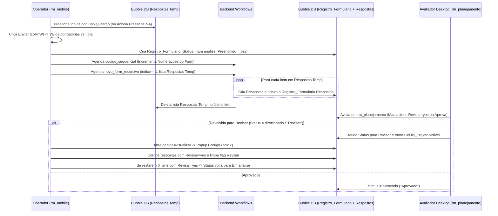
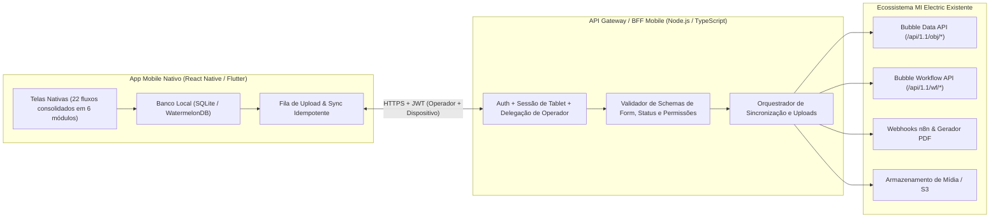

# Análise Técnica do `rmmi` e Arquitetura para Desacoplamento do `rm_mobile`

Este documento consolida a auditoria técnica completa do aplicativo **`rmmi`** (versão `test` / `Main` no Bubble.io) e dos sistemas satélites no workspace local ([`rm_report`](file:///e:/MI%20Electric/APIs/rm_report/README.md) e [`rm-gantt-tableau-main`](file:///e:/MI%20Electric/APIs/rm-gantt-tableau-main/README.md)), com foco específico no funcionamento da página **`rm_mobile`** (`ID: cnqvm`) e nos requisitos técnicos para transformá-la em uma **aplicação mobile real e independente**.

> [!IMPORTANT]
> **Descoberta Arquitetural Crítica (`rm_mobile` vs. `mobile_rm`):** O aplicativo Bubble possui dois artefatos de nomes semelhantes:
> 1. **`rm_mobile` (`ID: cnqvm`, `native_app=false`):** Página web responsiva tipo *Single-Page Application* (SPA) que concentra **toda a operação real de chão de fábrica** (951 nós de UI, 93 *custom states*, 22 subtelas roteadas por `?pagina=...`, 181 eventos e 462 ações).
> 2. **`mobile_rm` (`ID: coXpw`, View Nativa Mobile):** Esboço visual parcial com apenas 123 nós (restrito ao formulário inicial de recebimento) e **zero workflows implementados**.
>
> Portanto, a aplicação mobile real deve ser projetada a partir da engenharia reversa da página web **`rm_mobile`** e dos **32 Backend Workflows**, e não da view nativa `mobile_rm`.

---

## 1. Dimensão do Sistema e Inventário Auditado

Toda a estrutura da aplicação foi extraída e catalogada em **61 volumes técnicos locais** disponíveis no diretório de artefatos da sessão para consulta exata de expressões, IDs e parâmetros:

| Camada do Sistema | Escopo Auditado no `rmmi` | Volumes de Referência Local |
| :--- | :--- | :--- |
| **Visão Geral & Síntese** | 27 páginas web, 3 views nativas, 9 *reusables*, 258 estilos | [19_rmmi_inventario.md](file:///C:/Users/gavin/.gemini/antigravity/brain/b2d157b7-48d8-435f-aabd-2e29322deac6/scratch/extracted_pages/19_rmmi_invent_rio_completo_do_aplicativo_Bubble.md), [34_rmmi_analise_arquitetura.md](file:///C:/Users/gavin/.gemini/antigravity/brain/b2d157b7-48d8-435f-aabd-2e29322deac6/scratch/extracted_pages/34_rmmi_an_lise_t_cnica_completa_e_arquitetura_do_aplicativo_m_vel_indepe.md) |
| **Página `rm_mobile` (`cnqvm`)** | 951 nós, 22 subtelas, 93 *custom states*, 464 condições | [01_arvore_elementos.md](file:///C:/Users/gavin/.gemini/antigravity/brain/b2d157b7-48d8-435f-aabd-2e29322deac6/scratch/extracted_pages/01_rmmi_rm_mobile__rvore_completa_de_elementos.md), [23_rotas_custom_states.md](file:///C:/Users/gavin/.gemini/antigravity/brain/b2d157b7-48d8-435f-aabd-2e29322deac6/scratch/extracted_pages/23_rmmi_rm_mobile_rotas_par_metros_e_todos_os_custom_states.md), [33_indice_rm_mobile.md](file:///C:/Users/gavin/.gemini/antigravity/brain/b2d157b7-48d8-435f-aabd-2e29322deac6/scratch/extracted_pages/33_rmmi_rm_mobile__ndice_t_cnico_completo.md) |
| **Workflows do `rm_mobile`** | 181 eventos únicos e 462 ações com expressões completas | [14_indice_workflows.md](file:///C:/Users/gavin/.gemini/antigravity/brain/b2d157b7-48d8-435f-aabd-2e29322deac6/scratch/extracted_pages/14_rmmi_rm_mobile__ndice_de_todos_os_workflows.md) e Volumes `15` a `29` |
| **Buscas (`Search for`) no `rm_mobile`** | 158 consultas (89 em UI/condições e 69 em workflows) | [30_buscas_vol1.md](file:///C:/Users/gavin/.gemini/antigravity/brain/b2d157b7-48d8-435f-aabd-2e29322deac6/scratch/extracted_pages/30_rmmi_rm_mobile_cat_logo_de_buscas_e_constraints_volume_1.md), [31_buscas_vol2.md](file:///C:/Users/gavin/.gemini/antigravity/brain/b2d157b7-48d8-435f-aabd-2e29322deac6/scratch/extracted_pages/31_rmmi_rm_mobile_cat_logo_de_buscas_e_constraints_volume_2.md), [32_buscas_vol3.md](file:///C:/Users/gavin/.gemini/antigravity/brain/b2d157b7-48d8-435f-aabd-2e29322deac6/scratch/extracted_pages/32_rmmi_rm_mobile_cat_logo_de_buscas_e_constraints_volume_3.md) |
| **Modelo de Dados & Option Sets** | 98 *Data Types* (1.727 campos) e 49 *Option Sets* (681 opções) | [35_dados_vol1.md](file:///C:/Users/gavin/.gemini/antigravity/brain/b2d157b7-48d8-435f-aabd-2e29322deac6/scratch/extracted_pages/35_rmmi_Dicion_rio_completo_de_dados_volume_1.md), [37_dados_vol2.md](file:///C:/Users/gavin/.gemini/antigravity/brain/b2d157b7-48d8-435f-aabd-2e29322deac6/scratch/extracted_pages/37_rmmi_Dicion_rio_completo_de_dados_volume_2.md), [39_dados_vol3.md](file:///C:/Users/gavin/.gemini/antigravity/brain/b2d157b7-48d8-435f-aabd-2e29322deac6/scratch/extracted_pages/39_rmmi_Dicion_rio_completo_de_dados_CheckListNr12_a_Debug.md), [38_option_sets.md](file:///C:/Users/gavin/.gemini/antigravity/brain/b2d157b7-48d8-435f-aabd-2e29322deac6/scratch/extracted_pages/38_rmmi_Todos_os_Option_Sets_op__es_e_atributos.md) |
| **Regras de Privacidade** | 108 regras (98 *default* e 10 condicionais) | [36_privacidade_vol1.md](file:///C:/Users/gavin/.gemini/antigravity/brain/b2d157b7-48d8-435f-aabd-2e29322deac6/scratch/extracted_pages/36_rmmi_Regras_completas_de_privacidade.md), [40_privacidade_vol2.md](file:///C:/Users/gavin/.gemini/antigravity/brain/b2d157b7-48d8-435f-aabd-2e29322deac6/scratch/extracted_pages/40_rmmi_Regras_completas_de_privacidade_CheckListNr12_a_Numeracoes.md), [41_privacidade_vol3.md](file:///C:/Users/gavin/.gemini/antigravity/brain/b2d157b7-48d8-435f-aabd-2e29322deac6/scratch/extracted_pages/41_rmmi_Regras_completas_de_privacidade_Ordem_Servi_o_a_Device.md) |
| **Backend Workflows & APIs** | 32 *API Events* (68 ações), 20 chamadas *API Connector*, 40 plugins | [48_regras_backend.md](file:///C:/Users/gavin/.gemini/antigravity/brain/b2d157b7-48d8-435f-aabd-2e29322deac6/scratch/extracted_pages/48_rmmi_regras_de_neg_cio_e_contratos_do_backend.md), [46_api_connector.md](file:///C:/Users/gavin/.gemini/antigravity/brain/b2d157b7-48d8-435f-aabd-2e29322deac6/scratch/extracted_pages/46_rmmi_API_Connector_e_integra__es_externas.md), [47_plugins.md](file:///C:/Users/gavin/.gemini/antigravity/brain/b2d157b7-48d8-435f-aabd-2e29322deac6/scratch/extracted_pages/47_rmmi_plugins_e_contratos_de_integra__es.md) |
| **Vínculos com Demais Páginas** | 26 páginas web (10.451 nós, 1.506 eventos, 3.068 ações) | [59_matriz_paginas.md](file:///C:/Users/gavin/.gemini/antigravity/brain/b2d157b7-48d8-435f-aabd-2e29322deac6/scratch/extracted_pages/59_rmmi_Matriz_de_p_ginas_e_depend_ncias_de_rm_mobile.md), [60_leituras_escritas_permissoes.md](file:///C:/Users/gavin/.gemini/antigravity/brain/b2d157b7-48d8-435f-aabd-2e29322deac6/scratch/extracted_pages/60_rmmi_Leituras_escritas_e_permiss_es_entre_p_ginas.md), [50_reusables.md](file:///C:/Users/gavin/.gemini/antigravity/brain/b2d157b7-48d8-435f-aabd-2e29322deac6/scratch/extracted_pages/50_rmmi_Reutiliz_veis_e_depend_ncias_de_rm_mobile.md) |

---

## 2. Topologia do Ecossistema Atual e Vínculos de Integração

O `rm_mobile` não opera isoladamente: ele compartilha tabelas, *Option Sets*, fluxos de aprovação, geração de estrutura de células e gatilhos externos com as páginas desktop do Bubble e com serviços em Render, AWS S3 e n8n.

```mermaid
flowchart TD
    subgraph Entrada["Autenticação e Identificação"]
        IDX["index / login (Login de Sessão)"]
        CHK["check_mobile (2FA TOTP / Troca de Senha)"]
        IDN["identify (Matrícula + Palavra-chave -> EventoSistema)"]
    end

    subgraph Mobile["Operação Mobile (Página rm_mobile)"]
        REC["Recebimento e Abertura de Projeto"]
        CEL["Painel da Célula, Projetos e Prioridade"]
        FOT["Captura de Fotos Obrigatórias / Complementares"]
        FRM["Preenchimento de Formulários (Respostas Temp)"]
        APR["Ciclo de Aprovações e Liberação de Etapas"]
    end

    subgraph CoreDB["Banco de Dados Compartilhado (Bubble rmmi)"]
        DB_PRJ["ProjetoRM + Equipamento + Cliente"]
        DB_CEL["Celula_Projeto + Celulas + Tablet_Celula_User"]
        DB_FOT["Fotos RM + Documentos"]
        DB_FRM["Form + Questoes + Respostas Temp + Registro_Formulario + Respostas"]
        DB_APR["Aprovacao Form + Aprovaçao_etapas + Log_Aprocacao"]
    end

    subgraph BackendWF["Backend Workflows (32 API Events)"]
        WF_MAT["projetocell_copy / projetocell (Materialização)"]
        WF_FRM["novo_form_recursivo + codigo_sequencial + Preenche NA"]
        WF_REL["Gerar_relatorio / Gerar_relatorio_csv"]
    end

    subgraph Desktop["Páginas Desktop & Gestão"]
        DSK_PLN["rm_planejamento (PCP, Aprovação/Revisão de Forms, Deleção)"]
        DSK_GST["rm_gestao / settings_rm (Templates de Forms, Células, Tablets)"]
        DSK_PRJ["projeto / project_rm / proposta (Dossiê, Orçamento, Relatórios)"]
    end

    subgraph Externos["Integrações Externas"]
        EXT_N8N["n8n Webhooks (n8n-service-zeek.onrender.com)"]
        EXT_PDF["Serviço PDF (pdf-generator-ppu2.onrender.com)"]
        EXT_AUT["Serviço Auth TOTP (auth-y80m.onrender.com)"]
        EXT_APP["Bubble App Connector (guardian-ofc + mielectricadmissional)"]
        EXT_REP["RM Report Builder (App Desktop Python) & Gantt Tableau"]
    end

    IDX --> CHK
    IDX --> IDN
    IDN -->|"Envia User (Identidade Operacional)"| CEL
    REC --> DB_PRJ
    REC -->|"Enviar E-mail Orçamentos"| EXT_N8N
    CEL --> DB_CEL
    FOT --> DB_FOT
    FRM --> DB_FRM
    FRM -->|"Agenda"| WF_FRM
    APR --> DB_APR
    APR -->|"E-mail Orçamentos (Aprovação)"| EXT_N8N
    WF_FRM --> DB_FRM
    DSK_PLN -->|"Agenda"| WF_MAT
    WF_MAT --> DB_CEL
    WF_MAT --> DB_FOT
    WF_MAT --> DB_APR
    DSK_PLN -->|"Aprova / Devolve Revisar"| DB_FRM
    DSK_PLN -->|"Aprova / Devolve Revisar"| DB_APR
    DSK_GST --> DB_CEL
    DSK_GST --> DB_FRM
    DSK_PRJ --> WF_REL
    WF_REL --> EXT_PDF
    EXT_N8N --> EXT_REP
```

---

## 3. Análise Profunda da Página `rm_mobile` (`cnqvm`)

### 3.1. Modelo de Navegação e Parâmetros de URL
O `rm_mobile` funciona como uma SPA controlada por parâmetros de URL e pelo registro `User` enviado como conteúdo da página (`Current page's User`):

* **Conteúdo da Página (`Type of content`):** `user` — representa a **identidade operacional** do colaborador em campo (frequentemente distinta do `Current User` logado na sessão do tablet compartilhado).
* **Parâmetros de URL lidos via `GetParamFromUrl`:**
  1. `pagina` (`text`): Seletor da subtela ativa (22 rotas mapeadas abaixo).
  2. `projeto` (`custom.projeto_rm`): Unique ID do `ProjetoRM` em contexto.
  3. `celula` (`custom.celulas`): Unique ID da `Celulas` (célula produtiva da oficina).
  4. `form` (`custom.form1`): Unique ID do modelo de formulário (`Form`).

### 3.2. Mapa das 22 Subtelas Internas do `rm_mobile`

| Valor de `?pagina=` | Grupo Container no Bubble | ID | Função Operacional no Chão de Fábrica |
| :--- | :--- | :--- | :--- |
| `home` | `Group F` | `cnqyy` | Tela inicial de entrada com atalhos principais |
| `celula` | `Group Celula` | `coRhP` | Painel da célula vinculada ao tablet/usuário (`Tablet_Celula_User`) |
| `celulaProjetos` | `Group Celula projetos` | `coRjA` | Lista de projetos ativos na célula com busca, status e reordenação de prioridade |
| `dashboardCelula` | `Group Dashboard celula` | `coRkn` | Indicadores e contadores de desempenho/status da célula |
| `projeto` | `Group Projeto` | `coRpM` | Hub de execução de um projeto na célula (acesso a fotos, formulários, docs e aprovações) |
| `docs` | `Group Docs` | `coqyq` | Visualização de documentos/PDFs anexados ao projeto (`Documentos`) |
| `formrecebimento` | `Group Form Recebimento [s]` | `cnqwP` | Wizard em 7 etapas (`group Input dados A` a `G` + fotos) para recebimento de equipamento e abertura de projeto |
| `recebimentos` | `Group Recebidos` | `cnqzm` | Listagem de projetos em fase de recebimento |
| `selecionarProjeto` | `Group Selecionar projeto` | `coPWw` | Seleção de projeto existente para associação/atuação |
| `planejamento` | `Group Planejamento` | `cnrAY` | Visão móvel de informações de planejamento |
| `desmontagem` | `Group Desmontagem` | `cnrBN` | Visão de apoio à etapa de desmontagem/peritagem |
| `projetoRecebimento` | `Group Show Project [s]` | `cnrHr` | Detalhes do projeto recém-recebido (versão original) |
| `menuGaleria` | `Group Show Project [s] redesign` | `conWM` | Menu redesenhado de detalhes e galeria do projeto |
| `tipoFoto` | `Group Tipo fotos` | `coPZe` | Escolha entre Fotos Obrigatórias, Complementares ou Galeria |
| `fotoObrigatoria` | `Group Fotos obrigatorios` | `coPfU` | Captura/upload de fotos obrigatórias da célula (fluxo original) |
| `fotoObrigatoriaRedesign` | `Group Fotos obrigatorios redesign` | `coneG` | Captura/upload de fotos obrigatórias com câmera/galeria e legendas |
| `fotoComplementar` | `Group Fotos complementares` | `coPox` | Adição dinâmica de fotos extras na célula/projeto |
| `fotosGaleria` | `Group Fotos galeria` | `conkF0` | Galeria filtrável (`todas`, por `celula` ou `projeto`), lixeira e seleção |
| `formularios` | `Group Selecão Formulário` | `coVUa` | Lista de formulários atribuídos à célula para o projeto e seus status (`Pendente`, `Em analise`, `Revisar`, `Aprovado`) |
| `formulario` | `Group Registro Formulario` | `coVnL` | Motor de preenchimento dinâmico de questões, N/A em lote, assinatura e envio |
| `visualizar` | `Group Visualizaçao Formulario` | `coXHc` | Leitura de formulário enviado e acionamento de correção de itens em revisão (`Revisar`) |
| `aprovacoes` | `Group Lista de Aprovações` | `conRm` | Gestão de `Aprovaçao_etapas`: Aprovar, Liberar etapa, Retornar etapa ou Finalizar ciclo |

---

### 3.3. Detalhamento dos 5 Módulos Funcionais e Regras de Negócio

#### Módulo 1: Autenticação, Sessão de Tablet e Identidade Operacional
1. **Dupla Identidade (`Current User` vs. `Current page's User`):**
   - No chão de fábrica, um tablet pode estar autenticado com uma conta de sessão (`Current User`, perfil `Administrador` + tipo `Login`), enquanto o operador se identifica na página `identify` (`coZum`) informando **Matrícula** (`matricula3_text`) e **Palavra-chave** (`palavra_chave_text`).
   - O workflow `identify.coZyv` valida a palavra-chave, grava um log em `EventoSistema` e navega para `rm_mobile?pagina=celula` passando o `User` do operador como `Data to send`.
   - **Impacto na separação:** Em todas as gravações do `rm_mobile` (`Registro_Formulario`, `Aprovaçao_etapas`, `Comentarios`), o campo `Created By` nativo do Bubble reflete a sessão logada, enquanto campos como `Identidade` (`identidade_user`), `Created by` (`created_by_user`) e `aprovado_por_user` usam `Current page's User`. A API do novo app mobile **precisa suportar um token de sessão do dispositivo + um token/contexto de operador delegado validado no servidor**.
2. **Vínculo Tablet-Célula (`Tablet_Celula_User`):**
   - A tela `celula` descobre em qual célula produtiva o usuário está atuando fazendo `Search for Tablet_Celula_Users (usuario_user = Current User):first item`.

#### Módulo 2: Recebimento e Abertura de Projeto (`formrecebimento`)
1. **Wizard de Dados Iniciais:**
   - Controlado pelo custom state `currentSession` (`group Input dados A` até `G`) em `Group Buttons` (`coWJr`) e `pagina` (`1` = dados, `2` = fotos) em `Group Form Recebimento [s]`.
   - Coleta dados de `ProjetoRM` (Cliente, Nota Fiscal, Arquivo NF, Chegada do Equipamento, Parceiro, Escopo Abreviado, Data Contratual, Datas Previstas, Prazo, Eventualidades) e de `Equipamento` (Tipo, Fabricante, Modelo, Nº Série, Potência, Tensão, Corrente, Rotação, Frequência, Certificado, Forma, Peso, Grau IP, Placa Motor).
2. **Criação e Solicitação (`cojXG`, `cojXl`, `cofqG`):**
   - Ao avançar para fotos (`cojXG`), se o estado `ProjetoRM` estiver vazio, cria o registro em `ProjetoRM`, cria o registro em `Equipamento` e faz o vínculo bidirecional.
   - Em `cojXl`, cada foto inserida cria um registro em `Fotos RM` com `Categoria Foto = Obrigatória`, `tipo` (do Option Set `IdentificadorFoto`) e `Legenda`.
   - Ao clicar em **Solicitar Abertura** (`cofqG`), dispara a chamada API Connector **`Bubble n8n - Enviar E-mail Orçamentos`** (`https://n8n-service-zeek.onrender.com/webhook/ec394859-1698-4f1a-9d09-ce0742f1a72f`), limpa o estado e redireciona para `pagina=celula`.
   - **Atenção:** A materialização das células do projeto (`projetocell_copy`) **não ocorre automaticamente no mobile** hoje; ela é disparada posteriormente no desktop (`rm_planejamento` ou `proposta`) quando o PCP/Engenharia estrutura o projeto.

#### Módulo 3: Gestão de Fotos e Evidências (`Fotos RM`)
1. **Categorias e Estrutura:**
   - As fotos obrigatórias de cada célula são pré-instanciadas pelo workflow `projetocell_copy` (clonadas dos templates `Celula_Foto_Tipo_Equipamento` / `Fotos RM` sem projeto) quando o projeto é planejado no desktop.
   - No mobile, para fotos obrigatórias, o operador **atualiza** o registro `Fotos RM` já existente (preenchendo `foto1_image` ou a lista `fotos_list_image` e `legenda_text`).
   - Para fotos complementares, o mobile **cria** novos registros em `Fotos RM` com `Categoria Foto = Complementar` e os anexa à lista `Celula_Fotos_Tipo_Equipamento` da `Celula_Projeto`.
2. **Exclusão Lógica e Relatório:**
   - A exclusão na galeria usa o booleano `Lixeira` (`lixeira_boolean = true`). O campo `Seleçao_relatorio` controla quais fotos entram no relatório final gerado via PDF/n8n.

#### Módulo 4: Motor de Formulários Dinâmicos, Rascunhos e Revisão
Este é o subsistema mais complexo do `rm_mobile`:

1. **Tipos de Questão (`Option Set: Tipo Questão`):**
   - Suporta: `Texto Curto`, `Texto Longo`, `Numero` (com atributo `Dimensoes` para unidade de medida: `mm`, `A`, `V`, `Ω`, `MΩ`, `°C`, `bar`, `kgf/cm²`, `rpm`, `Hz`, etc.), `Data`, `Hora`, `Intervalo de Data`, `Lista Suspensa`, `Escolha Única` (Radio), `Caixas de Seleção` (Checkbox), `Lista Multi-Seleção`, `Foto`, `Foto Antes/Depois`, `Assinatura` (Canvas), `Colaborador`, `Cliente` e `Subtítulo` (divisor visual).
2. **Rascunhos (`Respostas Temp`) e Gargalo de Colisão:**
   - Enquanto o operador preenche, os valores ficam em `Respostas Temp`, buscados por `Projeto` e `Questão`.
   - **Problema Crítico Identificado:** As buscas de `Respostas Temp` filtram apenas por `Projeto` e `Questão` (sem filtrar por `User` ou por um ID de sessão de rascunho), e as 12 ações `NewThing` diretas nos inputs estão com `action_disabled=true` (dependendo de pré-existência ou do workflow `Preenche NA`). Em um app mobile nativo, o rascunho deve ser **local-first (SQLite/WatermelonDB)** ou isolado por `draft_id` + `operador_id` no servidor.
3. **Valores Sentinela de "N/A" (`Preenche NA` / `cooNJ`):**
   - Quando uma seção não se aplica, o workflow `Preenche NA` grava sentinelas específicos no banco: `"N/A"` para textos/seleções, `"0,000"` para números e timestamp `-2208977612000` (`1900-01-01`) para datas/horas. O backend do novo app deve conhecer essa convenção para manter compatibilidade com relatórios desktop existentes.
4. **Fluxo "Preencher Novo" (`Popup Preecher novo` / `comvr`):**
   - Hoje, clicar em "Preencher novo" **deleta permanentemente** as `Respostas` e o `Registro_Formulario` anterior antes de abrir um novo preenchimento.

#### Módulo 5: Ciclo de Aprovação de Etapas e Passagem de Célula (`aprovacoes`)
1. **Entidade `Aprovaçao_etapas` (`custom.aprovador_projeto`):**
   - Controla o *handover* (passagem de bastão) entre células produtivas (ex.: Desmontagem → Peritagem → Bobinagem → Montagem → Testes).
2. **As 4 Operações Distintas no Mobile:**
   - **Liberar Etapa (`copmq` - 13 passos):** Valida se o status da `Celula_Projeto` bate com `status_cel_proj`, grava auditoria em `Log_Aprocacao`, marca `status = Aprovado`, atualiza célula de destino (`celula_destino_custom_celulas`), verifica se `Vinculo_entre_celulas = no` para liberar a próxima célula como `Pendente` com `visibilidade1_boolean = true`, dispara webhook **`E-mail Orçamentos (Aprovação)`** para células específicas e oculta a célula atual quando não restam aprovações `Nulo`.
   - **Retornar Etapa (`copmY`):** Usado quando há reprovação/retrabalho (`Status = Retornado`). Marca `Reprovado`, reinicializa aprovações de retorno e reabre a célula de destino com status `Retornado`.
   - **Aprovar Etapa (`copzz`):** Registra aprovação simples (`Aprovado`), preenche `aprovado_por_user = Current page's User` e `data_aprovacao_date = Current date/time`.
   - **Finalizar Ciclo (`conwe`):** Oculta a `Celula_Projeto` (`visibilidade1_boolean = false`) ao encerrar a participação da célula.

---

## 4. Divergências de Chaves Internas (Option Sets) a Preservar

Um ponto vital para que o app mobile funcione em separado sem quebrar as páginas desktop (`rm_planejamento`, `projeto`, `rm_gestao`) é usar as **chaves internas (slugs do Bubble)** e não os textos de exibição (*Display*), pois vários *Option Sets* possuem rótulos diferentes de suas chaves internas:

| Option Set (`Chave`) | Opção (Chave Interna no Banco/API) | Rótulo Exibido na UI (`Display`) | Observação Crítica |
| :--- | :--- | :--- | :--- |
| **`Status Registro`** (`option.status_registro0`) | `pendente` `em_an_lise` `direcionado` `aprovado` | `Pendente` `Em analise` **`Revisar`** `Aprovado` | A chave interna para formulário em revisão é **`direcionado`**, embora a tela mostre **"Revisar"**. |
| **`Status Cel Proj`** (`option.status_cel_proj`) | `pendente` `em_dia` `atrasado` `bloqueado` `finalizado` `retornado` | `Pendente` **`Executando`** `Atrasado` `Bloqueado` `Finalizado` `Retornado` | A chave interna para célula em execução é **`em_dia`**, exibida como **"Executando"**. |
| **`Perfil assinante`** (`option.perfil_assinante`) | `executante` `aprovador` `qualidade` `gestor` | `Executante` **`Verificador`** `Qualidade` `Gestor` | A chave **`aprovador`** exibe **"Verificador"**. |
| **`Status PCP`** (`option.status_pcp`) | `revis_o_comercial` `revis_o_comercial0` | `Revisão comercial` `Revisão comercial` | Existem **duas opções duplicadas** com o mesmo rótulo e chaves diferentes. |

---

## 5. Riscos Críticos de Segurança e Arquitetura no `rmmi` Atual

> [!CAUTION]
> **Vulnerabilidades e Fragilidades Detectadas na Configuração Atual:**
> Antes de expor APIs para um aplicativo mobile distribuído em lojas ou APK corporativo, os seguintes pontos identificados na auditoria do Bubble precisam ser tratados ou encapsulados por um Backend/BFF:
>
> 1. **Exposição de Dados Sensíveis em `User`:** A regra de privacidade `User's own data` exige apenas `Current User is logged in` (para qualquer usuário logado, sem restringir `This User is Current User`) e marca `viewAll = true`, expondo campos como `cpf1_text`, `palavra_chave_text` (usada para assinar/identificar no tablet), `segredototp_text` e `qrcodetotp_image`.
> 2. **Endpoints Públicos sem Autenticação:** Os workflows de backend `reset_senha_interno_copy` (que redefine a senha de qualquer usuário para `"123456"`), `ordenacao_celulas` e `ordenacao_celula_projeto` estão com `expose = true`, `auth_unecessary = true` e `ignore_privacy_rules = true`.
> 3. **94 de 98 Tipos de Dados Totalmente Públicos na Leitura Padrão:** 94 tipos possuem regra *default* (`Everyone else`) com `viewAll = true`, `searchFor = true` e `viewAttachments = true`.
> 4. **Condição de Corrida em `codigo_sequencial` e `Prioridade`:** O incremento de numeração de formulário (`Numeracoes`) e a reordenação de posição de projetos na célula (`conAq`) são feitos em múltiplas etapas não atômicas.
> 5. **Deleção Órfã no Desktop (`rm_planejamento.coesh`):** Quando um gestor exclui um projeto no desktop, o sistema apaga `ProjetoRM`, `Celula_Projeto`, `Fotos RM` e `Registro_Formulario`, podendo gerar erro de referência em tablets que estavam preenchendo dados daquele projeto.

---

## 6. Plano Arquitetural para o Aplicativo Mobile Independente

Para que o módulo mobile funcione **100% em separado** (como um app nativo em **React Native / Expo** ou **Flutter**), mantendo compatibilidade total com o portal web/desktop do `rmmi`, recomenda-se a arquitetura **BFF (Backend-for-Frontend) + Offline-First**:

### 6.1. Consolidação das 22 Subtelas em 6 Módulos Nativos
Em vez de replicar as telas legadas/duplicadas do Bubble (como `fotoObrigatoria` vs. `fotoObrigatoriaRedesign` ou `projetoRecebimento` vs. `menuGaleria`), o app nativo deve estruturar-se em **6 fluxos limpos**:

1. **Autenticação & Turno do Operador:** Login corporativo/TOTP + Seleção rápida de Operador por Matrícula/Palavra-chave (para tablets compartilhados na oficina) + Vínculo automático de Célula (`Tablet_Celula_User`).
2. **Painel da Célula & Fila de Projetos:** Lista de `Celula_Projeto` (`visibilidade = true`), busca rápida por número da OS/Projeto, indicadores da célula e reordenação de prioridade (restrita a líderes/admin).
3. **Recebimento de Equipamentos (Wizard):** Passo a passo com salvamento local imediato dos dados do `ProjetoRM` e `Equipamento`, captura de fotos obrigatórias de chegada e disparo da solicitação ao comercial/PCP.
4. **Hub do Projeto na Célula:** Visão unificada do projeto selecionado contendo abas para **Checklist/Formulários**, **Fotos/Evidências**, **Documentos PDF** e **Comentários/Observações**.
5. **Motor Nativo de Formulários & Revisão:** Renderizador dinâmico dos 16 tipos de `Questoes` com rascunho 100% local (eliminando a lentidão e colisão da tabela `Respostas Temp`), botão "Preencher N/A", coleta de assinatura nativa offline, validação de obrigatórias e tela específica para corrigir apenas os itens marcados com `Revisar = true`.
6. **Central de Aprovações e Passagem de Etapa:** Lista de `Aprovaçao_etapas` pendentes para o operador com ações atômicas de **Aprovar**, **Liberar Etapa**, **Retornar Etapa** (com motivo obrigatório) e **Finalizar Ciclo**.

### 6.2. Contratos de API Necessários no BFF / Backend

| Endpoint do BFF Mobile | Operação e Vínculo com o `rmmi` |
| :--- | :--- |
| `POST /api/v1/auth/session` | Autentica usuário/tablet e valida 2º fator TOTP (`auth-y80m.onrender.com`). |
| `POST /api/v1/auth/operator-switch` | Valida `Matricula` + `Palavra-chave` no servidor (sem expor a tabela `User` ao cliente), cria registro em `EventoSistema` e emite token com `sessionUserId` + `operatorUserId`. |
| `GET /api/v1/bootstrap` | Retorna célula vinculada (`Tablet_Celula_User`), catálogo de `Celulas`, `Option Sets` (com chaves internas e *Displays*) e definições versionadas de `Form` + `Questoes` + `Itens_Questoes`. |
| `GET /api/v1/cells/:cellId/projects` | Retorna `Celula_Projeto` visíveis com `ProjetoRM`, `Equipamento` e contadores de progresso calculados no servidor. |
| `POST /api/v1/receiving/projects` | Cria transacionalmente `ProjetoRM` + `Equipamento` + `Fotos RM` iniciais e aciona o webhook n8n de abertura (`ec394859-1698-4f1a-9d09-ce0742f1a72f`). |
| `POST /api/v1/projects/:projectId/forms/:formId/submit` | Recebe o pacote completo de respostas do rascunho local com `clientOperationId` (idempotência), valida perguntas obrigatórias, cria `Registro_Formulario` (`status = em_an_lise`), gera `codigo_sequencial` sem corrida e cria os registros em `Respostas`. |
| `PATCH /api/v1/form-records/:recordId/revisions` | Atualiza respostas marcadas com `Revisar = true`, limpa a flag `Revisar` e, quando zeradas as pendências, transiciona `Registro_Formulario` e `Aprovacao Form` de `direcionado` (`Revisar`) para `em_an_lise`. |
| `POST /api/v1/projects/:projectId/photos` | Faz upload resiliente da imagem, cria/atualiza `Fotos RM` e sincroniza a lista em `Celula_Projeto`. |
| `POST /api/v1/approvals/:approvalId/decision` | Executa de forma atômica no servidor a lógica de **Liberar** (`copmq`), **Retornar** (`copmY`), **Aprovar** (`copzz`) ou **Finalizar** (`conwe`), gravando `Log_Aprocacao` e atualizando `Celula_Projeto` de origem e destino. |

---

## 7. Roteiro Recomendado de Execução

1. **Fase 1 — Saneamento e BFF (Sem impacto no Bubble atual):**
   - Fechar os 3 workflows públicos vulneráveis no Bubble (`reset_senha_interno_copy`, `ordenacao_celulas`, `ordenacao_celula_projeto`) e restringir a regra de privacidade de `User`.
   - Subir o serviço **BFF Mobile** (Node.js/TypeScript + Fastify/Express) conectado à Data API e Workflow API do `rmmi` (`https://rm.miconnect.app.br/api/1.1`).
2. **Fase 2 — App Mobile Core (Leitura, Identificação, Recebimento e Fotos):**
   - Implementar login + troca de operador por matrícula/palavra-chave, painel da célula, visualização de projetos/PDFs, wizard de recebimento e captura nativa de fotos com fila offline.
3. **Fase 3 — Motor de Formulários Offline-First e Aprovações:**
   - Implementar o renderizador dinâmico de `Form`/`Questoes` salvando rascunhos localmente no dispositivo e enviando o lote completo ao concluir, além do fluxo de revisão (`Popup Corrigir`) e aprovação de etapas (`Aprovaçao_etapas`).
4. **Fase 4 — Coexistência e Desligamento Gradual do `rm_mobile` Web:**
   - Operar o app nativo em paralelo com o `rm_planejamento` e `projeto` no desktop (já que ambos lerão e gravarão nas mesmas estruturas de `ProjetoRM`, `Celula_Projeto`, `Fotos RM` e `Registro_Formulario`).
