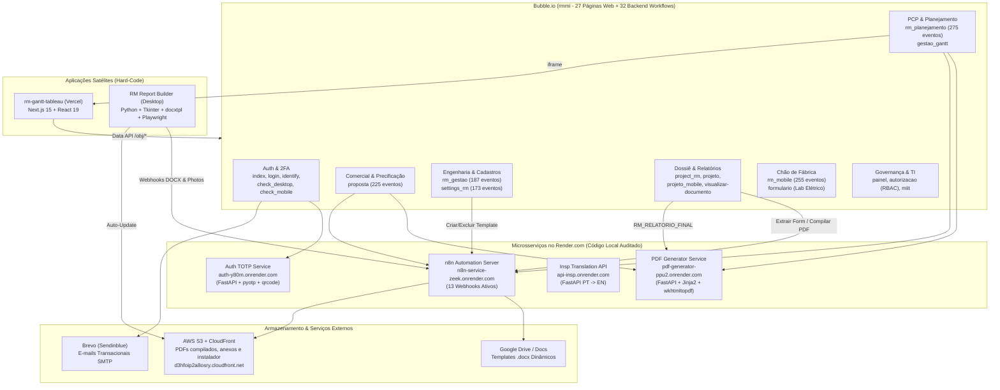
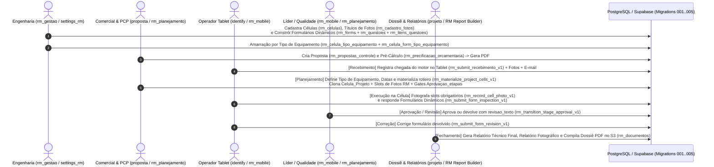

# Pacote de Mapeamento Completo e Blueprint de Recriação Hard-Code (`rmmi` — RM MI Connect)

Este artefato consolida a auditoria integral do aplicativo Bubble `rmmi` (`https://rm.miconnect.app.br`) — indo além do módulo operacional `rm_mobile` para cobrir **todas as 27 páginas web, 9 elementos reutilizáveis, 3 views nativas, 98 Data Types, 49 Option Sets, 108 regras de privacidade, 32 workflows de backend, 40 plugins** e **todas as integrações externas com Render, n8n, AWS S3/CloudFront, Google Docs e repositórios satélites locais**.

> [!IMPORTANT]
> **Descoberta Arquitetural Central — Dualidade de Domínios no `rmmi`:**
> A inspeção completa do código-fonte e do banco de dados revelou que o aplicativo Bubble `rmmi` hospeda **dois sistemas distintos** compartilhando a mesma instância:
> 1. **Sistema RM (Revisão de Motores — 23 páginas, 83 Data Types):** ERP/MES completo cobrindo Comercial/Propostas (`proposta`), PCP/Planejamento (`rm_planejamento`), Cronograma Gantt (`gestao_gantt`), Engenharia de Processos e Construtor de Formulários/Fotos (`rm_gestao`, `settings_rm`), Dossiê e Compilador de Relatórios (`project_rm`, `projeto`, `projeto_mobile`), Fichas Elétricas Laboratoriais (`formulario`), Chão de Fábrica (`rm_mobile`, `identify`), RBAC (`autorizacao`) e Suporte TI (`miit`).
> 2. **Sistema NR-12 ("Guardian" — 4 páginas, 15 Data Types):** Avaliação de Segurança de Máquinas (`projetos`, `rmclientselect`, `rmtemplate`, `settings`), cujo módulo mobile já foi recriado em React Native no repositório local [`README.md`](file:///e:/MI%20Electric/APIs/nr12-novo/README.md).

---

## 1. Arquitetura Global e Ecossistema de Integrações Atuais

O diagrama abaixo mapeia todas as conexões reais entre o Bubble (`rmmi`), os microsserviços hospedados no **Render**, os fluxos do **n8n**, o **AWS S3 / CloudFront**, o **Google Docs** e as aplicações satélites auditadas em `E:\MI Electric\APIs\`:

---

## 2. Mapeamento Detalhado das Integrações (Render, n8n, S3 e Apps Satélites)

Toda a especificação de payloads e respostas foi extraída de [`46_rmmi_API_Connector_e_integra__es_externas.md`](file:///C:/Users/gavin/.gemini/antigravity/brain/b2d157b7-48d8-435f-aabd-2e29322deac6/scratch/extracted_pages/46_rmmi_API_Connector_e_integra__es_externas.md), [`42_rmmi_backend_workflows_de_inspapi_a_gerar_relatorio_csv.md`](file:///C:/Users/gavin/.gemini/antigravity/brain/b2d157b7-48d8-435f-aabd-2e29322deac6/scratch/extracted_pages/42_rmmi_backend_workflows_de_inspapi_a_gerar_relatorio_csv.md) e cruzada com os códigos-fonte locais em [`main.py` (Auth)](file:///e:/MI%20Electric/APIs/Auth/main.py), [`main.py` (PDF Generator)](file:///e:/MI%20Electric/APIs/pdf_generator-main/pdf_generator-main/main.py) e [`app.py` (RM Report Builder)](file:///e:/MI%20Electric/APIs/rm_report/src/rm_report_builder/app.py).

### 2.1 Microsserviços no Render.com (3 Serviços)

| Serviço Render | URL de Produção | Código-Fonte Local | Endpoints e Contratos | Onde é Usado no `rmmi` | Estratégia no Hard-Code |
|---|---|---|---|---|---|
| **1. `Auth` (TOTP 2FA)** | `https://auth-y80m.onrender.com` | [`main.py`](file:///e:/MI%20Electric/APIs/Auth/main.py) | • `GET /generate?email=...` → `{secret, email}` • `POST /generate-qrcode` → `image/png` • `POST /verify` `{secret, token}` → `{status: "success"\|"error"}` • `GET /delete-all-qrcodes` | `check_desktop`, `check_mobile`, `Popup Auth A` (`cnymg0`), workflow `auth` (`cnyeY0`) | **Internalizar no Supabase Auth MFA** (ou validação TOTP nativa via `otpauth` em Edge Function usando `rm_private.user_credentials.segredo_totp`). |
| **2. `PDF_Proposta`** | `https://pdf-generator-ppu2.onrender.com` | [`main.py`](file:///e:/MI%20Electric/APIs/pdf_generator-main/pdf_generator-main/main.py) | • `POST /generate-generic-pdf` (Jinja2 + `wkhtmltopdf`) • `GET /send-pdf/{pdf_file_name}` • `GET /excluir-pdfs/{nome_arquivo.pdf}` • `POST /generate-report` (NR-12) | `proposta` e `rm_planejamento` (`Generate_pdf_proposta`), `project_rm` e `projeto` (`Gerar_relatorio` / `Gerar_relatorio_csv` com template `RM_RELATORIO_FINAL`) | **Manter container FastAPI existente** apontando o upload do PDF final diretamente para o bucket `rm-documentos` do Supabase Storage (eliminando o `PauseWFClient` de espera cega no cliente). |
| **3. `Insp` (Tradutor)** | `https://api-insp.onrender.com` | — | • `POST /translate/` `{word: "<Texto>"}` → `{Traducao: "..."}` | Workflow `inspapi` (`cnXxo`), página `testando` e laudos | Substituir por chamada direta a LLM/DeepL/Google Translate em Edge Function. |

### 2.2 Servidor de Automação n8n no Render (`https://n8n-service-zeek.onrender.com` — 13 Webhooks)

Cruzando o `API Connector` do Bubble (`coZeU`) com o arquivo [`config.local.json`](file:///e:/MI%20Electric/APIs/rm_report/config/config.local.json) do `RM Report Builder`, identificamos **13 webhooks ativos**:

| # | Call ID | Nome da Chamada | Método & Caminho no n8n | Entrada -> Saída | Função no Ecossistema |
|---:|---|---|---|---|---|
| 1 | `coZee` | `buscar-formulario` | `GET /webhook/buscar-formulario` | `?formulario_id=<id>` → `{file: "<url>"}` | Abre/baixa o PDF de um `Registro_Formulario` em `rm_planejamento`, `project_rm` e `projeto`. |
| 2 | `cofPx0` | `Enviar E-mail Orçamentos` | `POST /webhook/ec394859-1698-4f1a-9d09-ce0742f1a72f` | `{titulo, mensagem, imagens}` → `200` | Notifica time comercial/PCP na chegada de motor (`rm_mobile`) e em `rm_planejamento`. |
| 3 | `conno` | `E-mail Orçamentos (Aprovação)` | `POST /webhook/4e7a1788-5ebb-438b-a690-c510a9d35dad` | `{titulo, mensagem}` → `200` | Dispara e-mail no fluxo de aprovação de propostas (`proposta`, `rm_planejamento`). |
| 4 | `contd` | `E-mail Teste` | `POST /webhook-test/c1f6dd93-262d-4616-add8-9e930f16cf0a` | `{titulo, mensagem}` → `200` | Webhook de teste de disparo de e-mail. |
| 5 | `cogtC` | `Criar_template` | `POST /webhook/c7c66c40-dd0f-4ba2-94a0-1aacbb53992f` | `{link: "<docx_url>"}` → `{GoogleId}` | Converte `.docx` enviado em `rm_gestao` em documento Google Docs e retorna o `GoogleId` salvo em `Templates`. |
| 6 | `cogve0` | `Excluir_template` | `POST /webhook/22c70c6d-06b5-451e-ba4c-be6861ddbaeb` | `{googleID}` → `{id, success}` | Remove o template do Google Drive ao editar/excluir em `rm_gestao`. |
| 7 | `cogvg0` | `Download_template` | `POST /webhook/ff2357f6-69d8-4c86-ad8c-bef3874e16c1` | `{GoogleID}` → Binário `.docx` | Faz download do template `.docx` em `rm_gestao`. |
| 8 | `cohES0` | `Extrair Respostas Form` | `POST /webhook-test/c9a114fe-3e7a-4665-882f-ecf75ff3eb1a` | `{formulario: "<id>"}` → `{message}` | Prepara/extrai as respostas de um `Registro_Formulario` antes de gerar o relatório em `project_rm` e `projeto`. |
| 9 | `cohec` | `Download_pdf_n8n_s3` | `POST /webhook/9fd6e2aa-19c6-4464-ab46-97b5eece9407` | `{pdf: "<s3_url>"}` → Binário PDF | Baixa PDFs gerados no bucket S3 a partir de `project_rm`. |
| 10 | `cohfM` | `Gerar_relatorio_compilado` | `POST /webhook/df20ea5a-56e1-42df-a838-4fbaeb2a4585` | `{documentos: "<urls>", nome}` → `{file: "<s3_url>"}` | **Compilador de Dossiê:** mescla múltiplos PDFs de `Documentos` em um único PDF no S3 (`project_rm`, `projeto`). |
| 11 | `cohhE0` | `Upload_doc_s3` | `POST /webhook/598a4d68-77ca-4fe0-a026-0eb465ba1b2c` | `{file: "<url>", nome}` → `{file: "<s3_url>"}` | Transfere arquivos avulsos para o AWS S3 e registra em `Documentos` (`project_rm`, `projeto`). |
| 12 | `cogvq0` | `Gerar_relatório` (`n8n_webhook_docx_url`) | `POST /webhook/d862c716-b510-4b6e-abe1-3c0347df8389` | `{project_id, report_type: "docx", include_photos}` → JSON completo | Usado pelo app Desktop [`RM Report Builder`](file:///e:/MI%20Electric/APIs/rm_report/src/rm_report_builder/app.py#L363-L404) e por `project_rm`/`projeto` para montar relatórios Word/PDF. |
| 13 | `cohYQ0` | `Gerar_relatorio_fotografico` (`n8n_webhook_photos_url`) | `POST /webhook/9244fcd0-b83f-410d-9613-3e30aead1489` | `{project_id, projeto, report_type: "photos"}` → JSON de fotos | Usado pelo [`RM Report Builder`](file:///e:/MI%20Electric/APIs/rm_report/config/config.local.json#L1-L4) e por `project_rm` para gerar relatórios fotográficos de alta resolução. |

> [!WARNING]
> **Bugs Reais Descobertos na Configuração Atual do Bubble (`rmmi`):**
> 1. **URL quebrada em `buscar-formulario` (`coZee`):** No `API Connector`, a URL foi salva com a expressão literal `https://n8n-service-zeek.onrender.com/webhook/buscar-formulario?formulario_id=This Registro_Formulario's unique ID` fixada na string da chamada.
> 2. **Webhook em modo `/webhook-test/` em produção (`cohES0` e `contd`):** As chamadas `Extrair Respostas Form` (`cohES0`) e `E-mail Teste` (`contd`) apontam para `/webhook-test/...` no n8n, que só responde quando o editor do n8n está aberto com "Listen for test event" ativo.
> 3. **Endpoint público sem autenticação (`reset_senha_interno` `coSxN`):** Expõe `POST /api/1.1/wf/reset_senha_interno_copy` com `auth_unecessary=true` e `ignore_privacy_rules=true`, permitindo redefinir a senha de qualquer usuário para `"123456"`.
> 4. **Loop extra em `ordena_form2` (`coTtm`):** Agenda `iteracao + 1` enquanto `iteracao <= count`, executando uma iteração órfã após o último item.

---

## 3. Fluxo Completo End-to-End Entre Desktop e Mobile (`rmmi`)

O diagrama abaixo sintetiza como todos os módulos Desktop (`proposta`, `rm_gestao`, `settings_rm`, `rm_planejamento`, `project_rm`, `projeto`) e o Chão de Fábrica (`identify`, `rm_mobile`, `projeto_mobile`) interagem sobre as mesmas tabelas:

---

## 4. Inventário do Pacote de Recriação Gerado no Workspace

Todo o pacote técnico para recriação completa do software com IA está estruturado em [`rm-mobile-supabase`](file:///e:/MI%20Electric/APIs/Mi%20Connect/rm-mobile-supabase/README.md):

| Camada | Arquivo Gerado no Workspace | Escopo Coberto |
|---|---|---|
| **1. Option Sets e Enums (SQL)** | [`001_rm_enums_and_option_sets.sql`](file:///e:/MI%20Electric/APIs/Mi%20Connect/rm-mobile-supabase/migrations/001_rm_enums_and_option_sets.sql) | Todos os Option Sets do `rmmi`, tabela `rm_option_sets` e funções `resolve_option_key` / `resolve_option_display` tratando divergências de chaves (`direcionado` ↔ `"Revisar"`, `em_dia` ↔ `"Executando"`). |
| **2. Tabelas Core & Chão de Fábrica (SQL)** | [`002_rm_core_tables.sql`](file:///e:/MI%20Electric/APIs/Mi%20Connect/rm-mobile-supabase/migrations/002_rm_core_tables.sql) | 29 tabelas centrais (`rm_users`, `rm_private.user_credentials`, `rm_clientes`, `rm_equipamentos`, `rm_projetos`, `rm_celulas`, `rm_celulas_projeto`, `rm_forms`, `rm_questoes`, `rm_itens_questoes`, `rm_registros_formulario`, `rm_respostas`, `rm_fotos`, `rm_aprovacao_etapas`, etc.). |
| **3. Workflows e RPCs Atômicas (SQL)** | [`003_rm_workflows_rpcs_and_triggers.sql`](file:///e:/MI%20Electric/APIs/Mi%20Connect/rm-mobile-supabase/migrations/003_rm_workflows_rpcs_and_triggers.sql) | 7 Stored Procedures transacionais (`rm_authenticate_operator_v1`, `rm_submit_recebimento_v1`, `rm_materialize_project_cells_v1`, `rm_submit_form_inspection_v1`, `rm_submit_form_revision_v1`, `rm_transition_stage_approval_v1`, `rm_record_cell_photo_v1`). |
| **4. Segurança RLS, Storage e Bridge (SQL)** | [`004_rm_rls_and_sync_bridge.sql`](file:///e:/MI%20Electric/APIs/Mi%20Connect/rm-mobile-supabase/migrations/004_rm_rls_and_sync_bridge.sql) | Políticas RLS por perfil, buckets do Supabase Storage (`rm-fotos`, `rm-assinaturas`, `rm-documentos`) e RPC `rm_apply_bubble_webhook_v1` para sincronização em tempo real com o Desktop Bubble. |
| **5. Comercial, Dossiê, Lab Elétrico e RBAC (SQL)** | [`005_rm_commercial_proposals_and_legacy_forms.sql`](file:///e:/MI%20Electric/APIs/Mi%20Connect/rm-mobile-supabase/migrations/005_rm_commercial_proposals_and_legacy_forms.sql) | 20 tabelas adicionais cobrindo **100% do Desktop RM**: RBAC (`rm_elementos_permissao` + função `rm_user_has_element_permission`), Comercial (`rm_propostas_controle`, `rm_propostas_budgetarias`, `rm_precificacao_orcamentaria`, `rm_escopo_rm`, `rm_materiais`, `rm_pecas_rm`), Relatórios/S3 (`rm_templates_word`, `rm_documentos`, `rm_docs`), Fichas Laboratoriais (`rm_ordens_servico`, `rm_fichas_desmontagem`, `rm_ensaios_eletricos_laboratorio`) e Suporte (`rm_solicitacoes_suporte`). |
| **6. Contratos de Integrações (Blueprint)** | [`01_integracoes_render_n8n_s3_contratos.md`](file:///e:/MI%20Electric/APIs/Mi%20Connect/rm-mobile-supabase/blueprint/01_integracoes_render_n8n_s3_contratos.md) | Documentação completa de endpoints, headers, payloads JSON e arquitetura de substituição para Render (`Auth`, `PDF_Proposta`, `Insp`), os 13 webhooks n8n, AWS S3, `rm-gantt-tableau` e `RM Report Builder`. |
| **7. Especificação das 27 Páginas + Prompts IA (Blueprint)** | [`02_especificacao_paginas_e_prompts_ia.md`](file:///e:/MI%20Electric/APIs/Mi%20Connect/rm-mobile-supabase/blueprint/02_especificacao_paginas_e_prompts_ia.md) | Especificação página a página das 27 páginas web, 9 reutilizáveis, 3 views nativas, matriz RBAC (`PN*`, `CM*`, `PL*`, `GT*`, `CF*`, `DJ*`) e os **6 Prompts Mestres** para geração de código com IA. |
| **8. Scripts de ETL, Sync Worker e SQLite Offline** | [`etl_bubble_to_supabase.ts`](file:///e:/MI%20Electric/APIs/Mi%20Connect/rm-mobile-supabase/scripts/etl_bubble_to_supabase.ts), [`sync_worker_bubble_supabase.ts`](file:///e:/MI%20Electric/APIs/Mi%20Connect/rm-mobile-supabase/scripts/sync_worker_bubble_supabase.ts), [`sqlite_schema.ts`](file:///e:/MI%20Electric/APIs/Mi%20Connect/rm-mobile-supabase/mobile-offline/sqlite_schema.ts) | Extrator paginado da Data API do Bubble, worker bidirecional `Supabase <-> Bubble/n8n` e banco SQLite local para o app Expo. |
| **9. 61 Volumes Brutos Extraídos do Bubble MCP** | [`extracted_pages/`](file:///C:/Users/gavin/.gemini/antigravity/brain/b2d157b7-48d8-435f-aabd-2e29322deac6/scratch/extracted_pages) | ~1,9 MB de documentação estática contendo cada nó, estado, condição, busca, workflow e regra de privacidade do `rmmi`. |

---

## 5. Roteiro Recomendado de Execução da Recriação Hard-Code

1. **Fase 1 — Banco Unificado no Supabase + App Mobile (`rm_mobile` + `identify`):**
   - Aplicar [`001`](file:///e:/MI%20Electric/APIs/Mi%20Connect/rm-mobile-supabase/migrations/001_rm_enums_and_option_sets.sql) a [`005`](file:///e:/MI%20Electric/APIs/Mi%20Connect/rm-mobile-supabase/migrations/005_rm_commercial_proposals_and_legacy_forms.sql) no projeto Supabase, rodar o [`etl_bubble_to_supabase.ts`](file:///e:/MI%20Electric/APIs/Mi%20Connect/rm-mobile-supabase/scripts/etl_bubble_to_supabase.ts) e ativar o [`sync_worker_bubble_supabase.ts`](file:///e:/MI%20Electric/APIs/Mi%20Connect/rm-mobile-supabase/scripts/sync_worker_bubble_supabase.ts).
   - Executar o **Prompt 6** de [`02_especificacao_paginas_e_prompts_ia.md`](file:///e:/MI%20Electric/APIs/Mi%20Connect/rm-mobile-supabase/blueprint/02_especificacao_paginas_e_prompts_ia.md) para gerar o app **React Native (Expo)** offline-first para os tablets da fábrica.
2. **Fase 2 — Migração Imediata do Gantt (`rm-gantt-tableau`) e Dossiê (`projeto` / `RM Report Builder`):**
   - Apontar o [`rm-gantt-tableau`](file:///e:/MI%20Electric/APIs/rm-gantt-tableau-main/README.md) diretamente para o Supabase e criar a RPC de relatório para o [`RM Report Builder`](file:///e:/MI%20Electric/APIs/rm_report/README.md).
3. **Fase 3 — Recriação do Web Desktop em Next.js 15 (Prompts 1 a 5):**
   - Construir os módulos Web Desktop (`painel`, `autorizacao`, `rm_gestao`, `settings_rm`, `rm_planejamento`, `proposta`, `projeto`, `formulario`) em Next.js 15 sobre o mesmo banco Supabase e desligar definitivamente a assinatura do Bubble.
