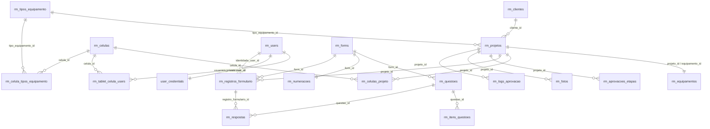
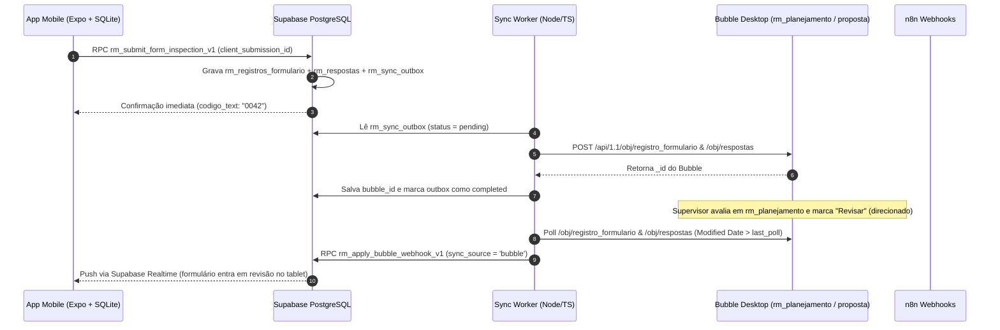

# Plano de Migração Direta PostgreSQL / Supabase — `rm_mobile`

Este documento consolida a modelagem relacional, os contratos transacionais (RPCs), o pipeline de ETL e a ponte de sincronização bidirecional temporária (`Supabase <-> Bubble Desktop / n8n`) construídos em [`e:/MI Electric/APIs/Mi Connect/rm-mobile-supabase/`](file:///e:/MI%20Electric/APIs/Mi%20Connect/rm-mobile-supabase/README.md).

---

## 1. Arquivos Gerados no Workspace

| Arquivo | Função |
| --- | --- |
| [001_rm_enums_and_option_sets.sql](file:///e:/MI%20Electric/APIs/Mi%20Connect/rm-mobile-supabase/migrations/001_rm_enums_and_option_sets.sql) | Cria o schema privado `rm_private`, a tabela de tradução `public.rm_option_sets`, todos os `ENUM`s canônicos e as funções `rm_private.resolve_option_key` e `rm_private.resolve_option_display`. |
| [002_rm_core_tables.sql](file:///e:/MI%20Electric/APIs/Mi%20Connect/rm-mobile-supabase/migrations/002_rm_core_tables.sql) | DDL completo das 29 tabelas (`public.rm_*` + `rm_private.user_credentials`), isolando CPF, hash de palavra-chave e segredo TOTP fora do schema público. |
| [003_rm_workflows_rpcs_and_triggers.sql](file:///e:/MI%20Electric/APIs/Mi%20Connect/rm-mobile-supabase/migrations/003_rm_workflows_rpcs_and_triggers.sql) | Fila `public.rm_sync_outbox` e 7 RPCs transacionais que substituem os workflows recursivos do Bubble e as cadeias de ações do `rm_mobile`. |
| [004_rm_rls_and_sync_bridge.sql](file:///e:/MI%20Electric/APIs/Mi%20Connect/rm-mobile-supabase/migrations/004_rm_rls_and_sync_bridge.sql) | Políticas RLS em todas as tabelas, buckets do Supabase Storage (`rm-fotos`, `rm-assinaturas`, `rm-documentos`), publicação `supabase_realtime` e RPC `rm_apply_bubble_webhook_v1`. |
| [etl_bubble_to_supabase.ts](file:///e:/MI%20Electric/APIs/Mi%20Connect/rm-mobile-supabase/scripts/etl_bubble_to_supabase.ts) | Extrator paginado da Data API do Bubble em ordem topológica de dependências, com tradução de Option Sets, geração automática de stubs e modo `--dry-run`. |
| [sync_worker_bubble_supabase.ts](file:///e:/MI%20Electric/APIs/Mi%20Connect/rm-mobile-supabase/scripts/sync_worker_bubble_supabase.ts) | Worker de sincronização bidirecional temporária (`Supabase -> Bubble / n8n` via outbox e `Bubble Desktop -> Supabase` via polling incremental). |
| [sqlite_schema.ts](file:///e:/MI%20Electric/APIs/Mi%20Connect/rm-mobile-supabase/mobile-offline/sqlite_schema.ts) | Schema SQLite offline-first (`expo-sqlite`) para o app React Native, eliminando a tabela `Respostas Temp` compartilhada durante o preenchimento em campo. |

---

## 2. Diagrama Entidade-Relacionamento (Supabase PostgreSQL)

---

## 3. Substituição de Workflows do Bubble por RPCs Transacionais no Supabase

| Fluxo em `rm_mobile` / Backend Bubble | Problemas no Bubble Atual | Novo RPC no PostgreSQL (`003_rm_workflows_rpcs_and_triggers.sql`) |
| --- | --- | --- |
| **Identificação de Operador** (`identify` — `coZum`) | Compara `palavra_chave_text` em texto claro; expõe tabela `User` inteira ao cliente. | `public.rm_authenticate_operator_v1`: valida credencial em `rm_private.user_credentials`, faz upgrade transparente para `bcrypt`, atualiza `rm_tablet_celula_users.identidade_id` e grava `rm_eventos_sistema`. |
| **Recebimento de Equipamento** (`formrecebimento` — `cojXG`, `cojXl`, `cofqG`) | Múltiplas gravações cliente-servidor separadas; falha parcial deixa `ProjetoRM` sem `Equipamento` ou sem fotos. | `public.rm_submit_recebimento_v1`: cria `rm_projetos`, `rm_equipamentos` e `rm_fotos` na mesma transação e enfileira o webhook do n8n (`Enviar E-mail Orçamentos`) + sync para o Bubble. |
| **Materialização de Células** (`projetocell_copy` — `coZAA`) | Workflow recursivo lento que agenda 1 célula por vez. | `public.rm_materialize_project_cells_v1`: clona `rm_fotos` modelo (`projeto_id IS NULL`), `rm_aprovacoes_etapas` modelo e cria todas as `rm_celulas_projeto` em uma única transação set-based. |
| **Submissão de Inspeção** (`coVnW` + `codigo_sequencial` `coUMy` + `novo_form_recursivo` `cofnw`) | Concorrência em `Respostas Temp` entre operadores; `codigo_sequencial` sujeito a condição de corrida; recursão cria duplicatas se houver retry. | `public.rm_submit_form_inspection_v1`: idempotente por `client_submission_id`, reserva `codigo` via `UPSERT ... RETURNING` atômico em `rm_numeracoes` e grava `rm_registros_formulario` + lote de `rm_respostas` (`UNIQUE (registro_formulario_id, questao_id)`). |
| **Correção de Revisão** (`Popup Corrigir` — `cofgY`) | Atualiza respostas uma a uma via cliente; risco de estado inconsistente se a conexão cair no meio. | `public.rm_submit_form_revision_v1`: corrige todas as respostas em lote, limpa `revisar = false` e retorna `rm_registros_formulario.status` para `'em_an_lise'` (`revisado = true`). |
| **Aprovação de Etapas** (`copmq`, `copmY`, `copzz`, `conwe`) | Até 13 passos encadeados no cliente por clique. | `public.rm_transition_stage_approval_v1`: executa `'liberar'`, `'retornar'`, `'aprovar'` ou `'finalizar_ciclo'` com `SELECT ... FOR UPDATE`, atualiza `rm_celulas_projeto`, grava `rm_logs_aprovacao` e enfileira e-mail n8n. |

---

## 4. Arquitetura de Sincronização Híbrida Temporária (`Supabase <-> Bubble Desktop`)

---

## 5. Checklist no Bubble antes do ETL Inicial

Ao inspecionar [tmp-swagger-current.json](file:///e:/MI%20Electric/APIs/rm-gantt-tableau-main/tmp-swagger-current.json), verificamos que 11 tipos principais do RM já estão expostos em `/api/1.1/obj/...` (`celulas`, `user`, `form`, `questoes`, `projetorm`, `equipamento`, `celula_projeto`, `fotosrm`, `registro_formulario`, `respostas`, `documentos`).

> [!IMPORTANT]
> O script [etl_bubble_to_supabase.ts](file:///e:/MI%20Electric/APIs/Mi%20Connect/rm-mobile-supabase/scripts/etl_bubble_to_supabase.ts) já cria registros *stub* automaticamente caso os tipos auxiliares abaixo retornem HTTP 404, garantindo que nenhuma Foreign Key quebre. Contudo, para importar **100% dos metadados** desses tipos auxiliares no ETL inicial, habilite a caixa **"Enable Data API"** em **Bubble → Settings → API** para:
> - `Cliente` (`custom.cliente`)
> - `Equipes` (`custom.equipes1`)
> - `Tipo_Equipamento` (`custom.tipo_equipamento`)
> - `Celula_Tipo_Equipamento` (`custom.celula_tipo_equipamento`)
> - `Itens_Questoes` (`custom.itens_questoes3`)
> - `Numeracoes` (`custom.numeracoes`)
> - `Aprovaçao_etapas` (`custom.aprovador_projeto`)
> - `Tablet` (`custom.tablet`) e `Tablet_Celula_User` (`custom.celula_user`)
