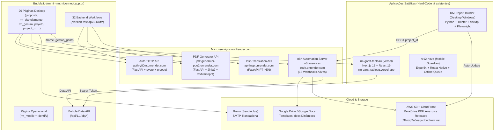

# Catálogo Completo de Integrações Externas (`rmmi` — Bubble, Render, n8n, AWS S3, Google Docs e Apps Satélites)

Este documento mapeia **100% das integrações externas** do ecossistema `rmmi`, cruzando a auditoria estática do Bubble (`API Connector`, `Backend Workflows`, `Plugins`) com o código-fonte real dos microsserviços locais em `E:\MI Electric\APIs\`.

---

## 1. Visão Geral da Topologia de Integrações



---

## 2. Microsserviços no Render.com (Com Código-Fonte Auditado)

### 2.1 Serviço 1: `Auth` — Autenticação 2FA TOTP (`https://auth-y80m.onrender.com`)
- **Código-Fonte Local:** [`E:\MI Electric\APIs\Auth\main.py`](file:///e:/MI%20Electric/APIs/Auth/main.py)
- **Stack:** Python + FastAPI + `pyotp` + `qrcode`
- **Coleção no Bubble API Connector:** `Auth` (`cnydu0`)

| Call ID Bubble | Nome no Bubble | Método e Endpoint | Parâmetros / Body | Resposta Esperada | Onde é chamado no Bubble |
|---|---|---|---|---|---|
| `cnydv0` | `Gerar segredo` | `GET /generate?email=<email>` | Query: `email` | `{"secret": "<BASE32>", "email": "..."}` | `check_mobile`, `check_desktop`, `settings`, `settings_rm` |
| `cnyeA0` | `Gerar qrcode` | `POST /generate-qrcode` | Body JSON: `{"secret": "<secret>", "email": "<email>", "app_name": "RM - MI Connect"}` | `image/png` (stream binário salvo no Bubble CDN em `User.qrCodeTOTP`) | Backend workflow `auth` (`cnyeY0`), `check_mobile`, `check_desktop` |
| `cnyeM0` | `Excluir imagens` | `GET /delete-all-qrcodes` | Sem parâmetros | `{"message": "All QR codes have been deleted"}` | Chamado imediatamente após `Gerar qrcode` para limpar disco efêmero do Render |
| `cnyeN0` | `Verificar` | `POST /verify` | Body JSON: `{"secret": "<secret>", "token": "<6-digit-code>"}` | `{"status": "success", "message": "Token is valid"}` ou `"status": "error"` | Reutilizável `Popup Auth A` (`cnymg0`), `check_mobile`, `check_desktop` |

> **Como substituir no Hard-Code:** O **Supabase Auth** possui MFA TOTP nativo (`supabase.auth.mfa.enroll({ factorType: 'totp' })`, `challenge`, `verify`). Caso deseje manter compatibilidade com os segredos Base32 já salvos em `rm_users.segredo_totp`, basta validar com a biblioteca `otplib` / `otpauth` diretamente em uma Supabase Edge Function sem precisar de container no Render.

---

### 2.2 Serviço 2: `PDF_Proposta` — Gerador de Propostas e Relatórios (`https://pdf-generator-ppu2.onrender.com`)
- **Código-Fonte Local:** [`E:\MI Electric\APIs\pdf_generator-main\pdf_generator-main\main.py`](file:///e:/MI%20Electric/APIs/pdf_generator-main/pdf_generator-main/main.py)
- **Stack:** Python + FastAPI + `Jinja2` + `pdfkit` (`wkhtmltopdf 0.12.6.1`), com discos montados em `/app/output_path` e `/app/templates`.
- **Coleção no Bubble API Connector:** `PDF_Proposta` (`cnxTy`)

| Call ID Bubble | Nome no Bubble | Método e Endpoint | Body / Parâmetros | Resposta | Uso no `rmmi` |
|---|---|---|---|---|---|
| `cnxUC` | `Gerar pdf` | `POST /generate-generic-pdf` | JSON dinâmico contendo `template_folder`, `pdf_file_name`, `orientation`, `margin_top`, `margin_bottom`, `margin_left`, `margin_right`, `zoom` e todas as variáveis Jinja2 do template | `{"message": "PDF created successfully", "pdf_path": "..."}` | Backend workflows `generate_pdf_proposta` (`cnxTq`), `gerar_relatorio` (`coXhO`) e `gerar_relatorio_csv` (`coXkm`) |
| `cnxUF` | `Download pdf` | `GET /send-pdf/[pdf_file_name]` | Path param: `pdf_file_name` | Stream `application/pdf` | Download/abertura direta após pausa no cliente (`OpenURL`) |
| `coTde` | `Excluir pdf` | `GET /excluir-pdfs/[nome_arquivo.pdf]` | Path param: `nome_arquivo.pdf` | `{"message": "..."}` | Limpeza do disco no Render |
| — | Endpoints extras NR-12 no mesmo serviço | `POST /generate-report`, `POST /generate-full-report`, `POST /preview-report` | Dados de Apreciação de Risco NR-12 | Stream PDF / HTML | Páginas NR-12 (`projetos`, `rmtemplate`) |

#### Templates Jinja2 mapeados no `PDF_Proposta`:
1. **Propostas Comerciais (`proposta`, `rm_planejamento`):**
   - `proposta_comercial_ex_manutençao_basica_pt-br` (e variantes `_en`, `_es`, `_geral`, `_padrao`).
   - Variáveis de contrato enviadas em `Json_tags`: `codigo_proposta`, `data_emissao`, `cliente_nome`, `cliente_cnpj`, `contato_nome`, `vendedor_nome`, `fabricante`, `potencia_cv`, `potencia_kw`, `tensao`, `corrente`, `rotacao`, `carcaca`, `frequencia`, `grau_ip`, `certificado_ex`, `escopo_basico[]`, `escopo_complementar[]`, `pecas[]`, `valor_total`, `prazo_entrega`, `incoterms`, `condicao_pagamento`, `validade_proposta`.
2. **Relatório Técnico Final (`project_rm`, `projeto` -> `gerar_relatorio` / `gerar_relatorio_csv`):**
   - `template_folder`: `"RM_RELATORIO_FINAL"`
   - `pdf_file_name`: `"Relatório_Técnico_Final-<NomeProjeto>.pdf"`
   - Payload exato (extraído de `coXhW`):
     ```json
     {
       "template_folder": "RM_RELATORIO_FINAL",
       "pdf_file_name": "Relatório_Técnico_Final-RM001.pdf",
       "orientation": "portrait",
       "margin_top": "23mm",
       "margin_bottom": "18.5mm",
       "margin_left": "0",
       "margin_right": "0",
       "zoom": "1.0",
       "cliente": "...",
       "nome": "...",
       "tipo_equipamento": "...",
       "chegada_equipamento": "dd/mm/yyyy",
       "data_contratual": "dd/mm/yyyy",
       "data_prevista_inicio": "dd/mm/yyyy",
       "fabricante": "...",
       "modelo": "...",
       "numero_serie": "...",
       "potencia": "...",
       "tensao": "...",
       "corrente": "...",
       "rotacao": "...",
       "frequencia": "...",
       "certificado": "...",
       "forma": "...",
       "peso": "...",
       "grau": "...",
       "galeria": [ /* objetos de foto */ ],
       "questao": [ /* objetos de resposta de formulário */ ]
     }
     ```

---

### 2.3 Serviço 3: `Insp` — Tradutor Automático (`https://api-insp.onrender.com`)
- **Coleção no Bubble API Connector:** `Insp` (`cnXxm`), Call `cnXxn` (`API Call`)
- **Contrato:** `POST https://api-insp.onrender.com/translate/` com body `{"word": "<Texto>"}` -> retorna `{"Traducao": "<Translated text>"}`.
- **Uso:** Backend workflow `inspapi` (`cnXxo`) e página `testando` (`cnXxp`).

---

## 3. Servidor de Automação n8n (`https://n8n-service-zeek.onrender.com`)

Foram identificados **13 Webhooks n8n** no ecossistema (11 configurados no `API Connector` do Bubble sob a coleção `Bubble n8n` `coZeU` + 2 chamados diretamente pelo aplicativo desktop `RM Report Builder` e referenciados em workflows de `project_rm` / `projeto`):

| # | Call ID Bubble | Nome da Integração | Método e Webhook Path no n8n | Payload de Entrada | Payload de Retorno | Páginas / Sistemas que Chamam |
|---|---|---|---|---|---|---|
| 1 | `coZee` | `buscar-formulario` | `GET /webhook/buscar-formulario?formulario_id=<id>` | Query: `formulario_id` (ID de `Registro_Formulario`) | `{"file": "<url_pdf_ou_doc>"}` | `rm_planejamento`, `project_rm`, `projeto` (⚠️ **Bug no Bubble:** URL salva com literal `?formulario_id=This Registro_Formulario's unique ID`) |
| 2 | `cofPx0` | `Enviar E-mail Orçamentos` | `POST /webhook/ec394859-1698-4f1a-9d09-ce0742f1a72f` | `{"titulo": "...", "mensagem": "...", "imagens": "..."}` | `200 OK` ( texto/vazio ) | `rm_planejamento`, `proposta` |
| 3 | `conno` | `E-mail Orçamentos (Aprovação)` | `POST /webhook/4e7a1788-5ebb-438b-a690-c510a9d35dad` | `{"titulo": "...", "mensagem": "..."}` | `200 OK` | `proposta`, `rm_planejamento` |
| 4 | `contd` | `E-mail Teste` | `POST /webhook-test/c1f6dd93-262d-4616-add8-9e930f16cf0a` | `{"titulo": "...", "mensagem": "..."}` | `200 OK` | Testes de disparo |
| 5 | `cogtC` | `Criar_template` | `POST /webhook/c7c66c40-dd0f-4ba2-94a0-1aacbb53992f` | `{"link": "<url_docx_bubble_cdn>"}` | `{"GoogleId": "<google_doc_id>"}` | `rm_gestao` (criação/atualização de `Templates` Word no Google Docs) |
| 6 | `cogve0` | `Excluir_template` | `POST /webhook/22c70c6d-06b5-451e-ba4c-be6861ddbaeb` | `{"googleID": "<google_doc_id>"}` | `{"id": "...", "success": true}` | `rm_gestao` (exclusão/substituição de `Templates`) |
| 7 | `cogvg0` | `Download_template` | `POST /webhook/ff2357f6-69d8-4c86-ad8c-bef3874e16c1` | `{"GoogleID": "<google_doc_id>"}` | Binário `.docx` (`file`) | `rm_gestao` (download do template `.docx`) |
| 8 | `cohES0` | `Extrair Respostas Form` | `POST /webhook-test/c9a114fe-3e7a-4665-882f-ecf75ff3eb1a` | `{"formulario": "<registro_formulario_id>"}` | `{"message": "Workflow was started"}` | `project_rm` (`cohaI`), `projeto` (`cojAt`) — extrai respostas do `Registro_Formulario` antes de gerar relatório |
| 9 | `cohec` | `Download_pdf_n8n_s3` | `POST /webhook/9fd6e2aa-19c6-4464-ab46-97b5eece9407` | `{"pdf": "<pdflink>"}` | Binário PDF (`file`) | `project_rm` (`cohfC`) — baixa PDF armazenado no S3 |
| 10 | `cohfM` | `Gerar_relatorio_compilado` | `POST /webhook/df20ea5a-56e1-42df-a838-4fbaeb2a4585` | `{"documentos": "<lista_urls_s3_separadas_por_virgula>", "nome": "<nome_compilado>"}` | `{"file": "<s3_url_pdf_compilado>"}` | `project_rm` (`cohgt`), `projeto` (`cojDV`) — mescla múltiplos PDFs da tabela `Documentos` em um único dossiê |
| 11 | `cohhE0` | `Upload_doc_s3` | `POST /webhook/598a4d68-77ca-4fe0-a026-0eb465ba1b2c` | `{"file": "<bubble_cdn_url>", "nome": "<nome>"}` | `{"file": "<s3_url>"}` | `project_rm` (`cohhK`), `projeto` (`cojCO`) — transfere documento avulso para o bucket S3 e salva em `Documentos` |
| 12 | `cogvq0` / `RM Report Builder` | `Gerar_relatório` / `n8n_webhook_docx_url` | `POST /webhook/d862c716-b510-4b6e-abe1-3c0347df8389` | `{"project_id": "<id>", "report_type": "docx", "include_photos": true}` | JSON completo do projeto, equipamento, células, formulários e respostas para renderização `.docx` | `RM Report Builder` (`config.local.json`), `project_rm` (`cohaK`), `projeto` (`cojAu`) |
| 13 | `cohYQ0` / `RM Report Builder` | `Gerar_relatorio_fotografico` / `n8n_webhook_photos_url` | `POST /webhook/9244fcd0-b83f-410d-9613-3e30aead1489` | `{"project_id": "<id>", "projeto": "<id>", "report_type": "photos", "include_photos": true}` | JSON com metadados do projeto e array de fotos (`Fotos RM`) organizadas por célula/fase | `RM Report Builder` (`config.local.json`), `project_rm` (`cohZY0`) |

---

## 4. Aplicações Satélites e Conectores Entre Apps Bubble

### 4.1 `rm-gantt-tableau` (`E:\MI Electric\APIs\rm-gantt-tableau-main`)
- **Hospedagem:** `https://rm-gantt-tableau.vercel.app` (embutido via `<iframe>` na página `gestao_gantt` `cooGA`).
- **Como consome o Bubble hoje:** Faz requisições `GET` autenticadas por Bearer Token (`BUBBLE_API_TOKEN`) para `https://rm.miconnect.app.br/version-test/api/1.1/obj/{projetorm, celula_projeto, celulas, equipamento}` com paginação `cursor`/`limit=100` em `src/lib/bubble.ts`.
- **Como migrar para o Supabase:** Substituir `src/lib/bubble.ts` por uma consulta única ao Supabase (`supabase.from('rm_projetos').select('*, rm_equipamentos(*), rm_celulas_projeto(*, rm_celulas(*))')`), reduzindo o tempo de carregamento de ~4 segundos (múltiplas páginas REST do Bubble) para <150ms.

### 4.2 `RM Report Builder` (`E:\MI Electric\APIs\rm_report`)
- **Distribuição:** Bucket AWS S3 `s3://mi-electric-releases/rm-report-builder` + CloudFront `https://d3hfoip2a8osry.cloudfront.net/rm-report-builder/latest.json`.
- **Como migrar para o Supabase:** O webhook n8n (`d862c716...` e `9244fcd0...`) ou uma RPC do Supabase (`rm_get_project_report_payload_v1(p_project_id)`) passa a retornar exatamente o mesmo JSON a partir das tabelas `rm_projetos`, `rm_equipamentos`, `rm_celulas_projeto`, `rm_registros_formulario`, `rm_respostas` e `rm_fotos`, sem quebrar o aplicativo Desktop existente.

### 4.3 `Bubble App Connector` (Integrações com outros apps Bubble da MI Electric)
Configurado no plugin `Bubble App Connector` (`appconnector`):
1. **`mielectricadmissional`**: Call `Run Mielectricadmissional ASO` — integração com o app de RH/Admissional.
2. **`guardian-ofc`**: Calls `Run Guardian-ofc Novo_Form` e `Run Guardian-ofc Form_Item` — integração com o app oficial Guardian (NR-12).
