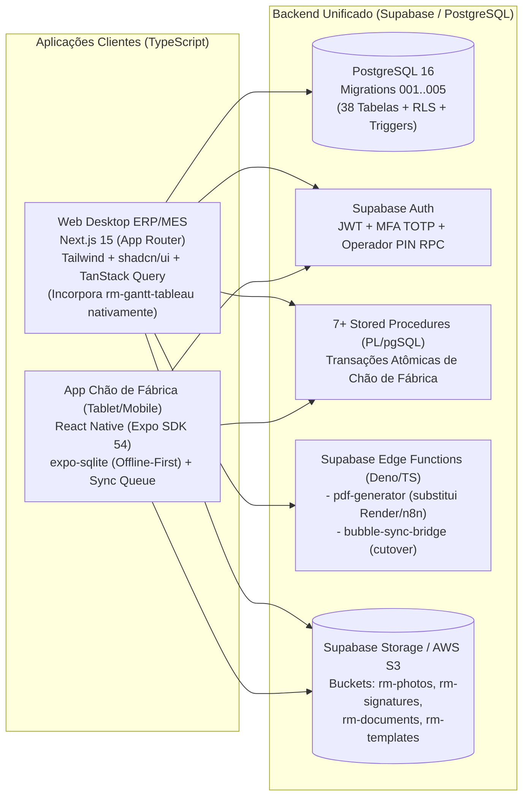

# Especificação Funcional de Todas as Páginas, Matriz RBAC e Prompts de Recriação com IA (`rmmi`)

Este documento detalha cada uma das **27 páginas web**, **9 elementos reutilizáveis**, **3 views nativas**, a **Matriz Completa de Permissões RBAC (`Elemento`)** e os **Prompts Estruturados para Agentes de IA** recriarem o software `rmmi` completo em código (**Next.js 15 App Router + React Native Expo + Supabase PostgreSQL**).

---

## 1. Mapa Completo das 27 Páginas Web, 9 Reutilizáveis e 3 Views Nativas

### 1.1 Domínio 1: RM — Revisão de Motores (ERP Comercial, PCP, Engenharia, Dossiê e Chão de Fábrica)

| # | Página Bubble | ID | Nós | Eventos / Ações | Módulo Alvo | Responsabilidade Funcional Completa |
|---|---|---|---:|---:|---|---|
| 1 | `index` | `bTGYf` | 42 | 6 / 40 | Auth & Roteamento | Login de usuários (`Tipo=Login`), recuperação por Magic Link/SMTP (Brevo), detecção de viewport (`<800px` redireciona para `identify`, `check_mobile` ou `projeto_mobile` se houver path de QR Code; `>=800px` redireciona para `painel`). |
| 2 | `login` | `coZuX` | 20 | 3 / 32 | Auth Legado | Tela alternativa de login para redirecionamento a `painel` ou `check_desktop`. |
| 3 | `identify` | `coZum` | 25 | 5 / 36 | Auth Chão de Fábrica | Terminal de identificação por `Palavra-chave` (`User.palavra_chave_text`) para operadores (`Tipo=Identidade`) em tablets compartilhados, abrindo `rm_mobile?pagina=celula`. |
| 4 | `check_desktop` | `coaEb` | 53 | 12 / 29 | 2FA & Troca de Senha | Primeiro acesso (`AlterarSenha=yes` -> chama `reset_senha`) e enrolamento/validação 2FA TOTP no Desktop via `Auth` Render (`auth-y80m.onrender.com`). |
| 5 | `check_mobile` | `cnyVs0` | 64 | 13 / 30 | 2FA Mobile | Equivalente móvel do `check_desktop` para troca de senha inicial e verificação TOTP antes de entrar em `rm_mobile`. |
| 6 | `reset_pw` | `AAL` | 9 | 3 / 5 | Auth | Redefinição padrão de senha do Bubble. |
| 7 | `painel` | `cmpUO` | 82 | 26 / 30 | Hub / Launcher | Portal central com controle de acesso por `Elemento` (`PN001`–`PN007`), seletor de idioma (`PT`/`EN`), detector de inatividade e navegação para Propostas, Planejamento, Gestão, Autorização, Configurações, Tutoriais e MIIT. |
| 8 | `proposta` | `coczM` | 1.267 | 225 / 511 | Comercial & Orçamentos | Gestão completa de propostas comerciais (`Firme` e `Estimada`), Pré-Cálculo (`Precificaçao Orçamentaria`), controle de revisões (`Proposta_controle`), geração de PDFs multilíngues (`PT`, `EN`, `ES`) via `Generate_pdf_proposta` (Render), disparo de e-mails de aprovação via n8n (`cofPx0`, `conno`) e dashboard comercial (`CM001`–`CM011`). |
| 9 | `rm_planejamento` | `coOJi0` | 2.043 | 275 / 676 | PCP & Planejamento | Criação de requisições de número de projeto (`ProjetoRM`), cadastro de `Equipamento`, instanciação automática do roteiro produtivo (`projetocell_copy` / `projetocell`), gestão de prazos/datas limites, aprovação ou reprovação de etapas/formulários (`Aprovaçao_etapas`, `Registro_Formulario`), pré-cálculo e orçamentos vinculados (`PL001`–`PL028`). |
| 10 | `rm_gestao` | `coQKn0` | 1.017 | 187 / 380 | Engenharia de Processos & Construtor de Formulários | Cadastro e ordenação drag-and-drop de `Celulas` (`ordenacao_celulas`), alocação de `Celula_Projeto`, **Construtor Dinâmico de Formulários (`Form`, `Questoes`, `Itens_Questoes`)**, vínculo de formulários e títulos de fotos por tipo de equipamento (`Celula_Tipo_Equipamento`, `Celula_Form_Tipo_Equipamento`, `Cadastro Fotos`), e gestão de `Templates` `.docx` no Google Docs via n8n (`GT001`–`GT025`). |
| 11 | `settings_rm` | `cnWjc` | 1.076 | 173 / 365 | Cadastros Mestres & Config RM | Gestão de Usuários (`Tipo=Login` e `Tipo=Identidade`), Clientes, Vendedores, Tipos de Equipamento, Células padrão, Formulários e parâmetros globais (`CF001`–`CF011`). |
| 12 | `project_rm` | `cnpGY` | 375 | 59 / 104 | Dossiê Técnico do Projeto (v1) | Visualização detalhada de um `ProjetoRM`: galeria de fotos obrigatórias e complementares (`Fotos RM`) com zoom/rotação/edição, inspeção de formulários respondidos (`Registro_Formulario` / `Respostas`), disparo de `gerar_relatorio` / `gerar_relatorio_csv` (Render) e relatórios n8n (`Documentos`). |
| 13 | `projeto` | `coiiy` | 575 | 74 / 128 | Dossiê Técnico & Compilador S3 (v2) | Evolução do `project_rm`: inclui geração de QR Code do projeto (`ProjetoRM`), gestão de anexos (`Docs`), upload de documentos avulsos para S3 (`Upload_doc_s3`), geração de relatório individual via n8n (`Extrair Respostas Form` + `Gerar_relatório`), **Compilador de Dossiê PDF (`Gerar_relatorio_compilado`)** e mural de `Comentarios` do projeto. |
| 14 | `projeto_mobile` | `cokxq` | 215 | 10 / 10 | Consulta Mobile por QR Code | Visualização somente-leitura otimizada para smartphone (acionada ao escanear o QR Code do motor) exibindo Galeria de Fotos (obrigatórias/complementares), Formulários respondidos e Histórico de Planejamento. |
| 15 | `visualizar-documento` | `copcZ` | 43 | 11 / 12 | Visualizador de Anexos | Visualizador dedicado para arquivos da tabela `Docs` com download direto. |
| 16 | `gestao_gantt` | `cooGA` | 46 | 16 / 20 | Cronograma Gantt | Moldura autenticada do Bubble que embute via `<iframe>` a aplicação Next.js `https://rm-gantt-tableau.vercel.app`. |
| 17 | `rm_mobile` | `cnqvm` | 812 | 255 / 676 | App Operacional de Chão de Fábrica (Tablet) | Aplicação SPA operacional completa com 8 sub-telas (`celula`, `recebimento`, `registro-form`, `revisao-form`, `aprovacao`, `confirmacao`, `formularios`, `peritagem`). |
| 18 | `formulario` | `coAOy0` | 2.075 | 7 / 32 | Fichas Laboratoriais Estáticas | Formulário técnico extenso (2.075 nós) dividido em seções para preenchimento de `Ficha Desmontagem`, `Teste Eletrico Inicial` e `Teste Eletrico Final` (com Resistência Ôhmica, Isolamento, Hipot, Surge Test, Dinâmico Rotativo, Elevação de Temperatura, Freio). |
| 19 | `autorizacao` | `cnCcs` | 184 | 32 / 52 | Gestão RBAC (`Elemento`) | Cadastro de códigos de permissão (`Elemento`: `PN*`, `PL*`, `GT*`, `CF*`, `CM*`, `DJ*`) e atribuição individual de permissões por funcionário (`permissoes_list_user`). |
| 20 | `miit` | `coTXK` | 85 | 21 / 51 | Administração de Contas TI / Suporte | Painel administrativo de suporte TI para criação rápida de contas de usuário, reset forçado de senha (`reset_senha_interno_copy`), ajuste de parâmetros de segurança (`tentativaslogin`, `ncharpass`, `TOTP-Auth`, janelas de horário) e chamados. |
| 21 | `tutoriais` | `cnyLp0` | 53 | 12 / 14 | Base de Conhecimento | Vídeos e guias de treinamento de uso do sistema. |
| 22 | `testando` | `cnXxp` | 6 | 1 / 2 | Sandbox | Página de teste da API de tradução `Insp`. |
| 23 | `404` | `AAU` | 1 | 0 / 0 | Sistema | Página de erro 404. |

### 1.2 Domínio 2: NR-12 — Segurança de Máquinas ("Guardian" / Legado Co-hospedado)
As 4 páginas abaixo pertencem ao sistema NR-12 (cujo módulo mobile já foi migrado para React Native em [`E:\MI Electric\APIs\nr12-novo`](file:///e:/MI%20Electric/APIs/nr12-novo/README.md)):
- **24. `projetos` (`cmpgj`):** Gestão de projetos e máquinas NR-12 (`ProjetoNr12`, `MaquinaNr12`, `CheckListNr12`).
- **25. `rmclientselect` (`cmvEE`):** Seleção de cliente para projetos NR-12.
- **26. `rmtemplate` (`cmvcb`):** Editor de laudos, checklists e cálculo HRN de NR-12 (1.608 nós).
- **27. `settings` (`cnCRr`):** Configurações e cadastros mestres do módulo NR-12.

### 1.3 Elementos Reutilizáveis (9) e Views Nativas (3)
- **Reutilizáveis Críticos:**
  1. `Popup Auth A` (`cnymg0`): Modal global de verificação 2FA TOTP e bloqueio por inatividade.
  2. ` Barra Lateral -Configurações` (`coPec`): Navegação lateral compartilhada.
  3. `Cabeçalho` (`coPfZ`): Barra superior com perfil, idioma, notificações e logout.
  4. `Riscos` (`coAUL`) & `Perigos` (`coAWp`): Seletores reutilizáveis do módulo NR-12.
- **Views Nativas (Experimento Incompleto no Bubble Native):**
  1. `mobile_rm` (`corPj`): 123 nós e **0 workflows** (apenas casca visual incompleta).
  2. `identificacao` (`corQv`): 15 nós e 2 workflows básicos.
  3. `blank` (`corNJ`): 19 nós e 0 workflows.

---

## 2. Matriz Completa de Códigos RBAC (`Elemento`)

No Bubble, a visibilidade e o clique de botões críticos são governados pela tabela `Elemento` (`rm_elementos_permissao`), verificando se `Current User` pertence a `Elemento.permissoes`:

| Prefixo | Módulo / Página | Códigos Mapeados | Ações Protegidas |
|---|---|---|---|
| `PN` | `painel` | `PN001` a `PN007` | Acesso aos cards do Painel: Propostas (`PN001`), Planejamento (`PN002`), Gestão (`PN003`), Configurações (`PN004`), Autorização (`PN005`), Tutoriais (`PN006`), MIIT (`PN007`). |
| `CM` | `proposta` (Comercial) | `CM001` a `CM011` | Criar/editar proposta firme ou estimada, aprovar orçamento, alterar tabela de precificação, enviar e-mail de orçamento, excluir proposta. |
| `PL` | `rm_planejamento` | `PL001` a `PL028` | Criar requisição de projeto, editar equipamento, aprovar/reprovar etapa (`Aprovaçao_etapas`), devolver formulário para revisão, excluir projeto, alterar datas contratuais. |
| `GT` | `rm_gestao`, `project_rm`, `projeto` | `GT001` a `GT025` | Criar/editar/excluir células (`GT001`–`GT003`), criar/editar formulários e questões, gerenciar templates Word, adicionar/editar/excluir fotos do dossiê, compilar relatórios PDF. |
| `CF` | `settings_rm`, `settings` | `CF001` a `CF011` | Criar/editar/excluir usuários, resetar senhas, cadastrar clientes, cadastrar tipos de equipamento e células padrão. |
| `DJ` | `autorizacao` | `DJ001` a `DJ013` | Criar/editar/excluir códigos `Elemento` (`DJ001`) e atribuir/revogar permissões de funcionários (`DJ013`). |

---

## 3. Arquitetura Alvo Recomendada (Full Hard-Code)



---

## 4. Pacote de Prompts para Recriação Assistida por IA (Módulo a Módulo)

Abaixo estão os **6 Prompts Mestres de Engenharia** prontos para serem fornecidos a agentes de IA (como Antigravity, Cursor, Claude Code) junto com os arquivos SQL (`migrations/001` a `005`) para gerar o código-fonte de cada módulo sem ambiguidade.

### Prompt 1 — Core Auth, 2FA TOTP, RBAC (`Elemento`) e Hub (`index`, `identify`, `painel`, `autorizacao`, `miit`)
```markdown
Construa em Next.js 15 (App Router, TypeScript, Tailwind CSS, shadcn/ui, @supabase/ssr) o módulo de Autenticação, Controle de Acesso (RBAC) e Portal Central do sistema RM - MI Connect, conectado ao schema PostgreSQL definido em `migrations/001..005`:
1. Login Corporativo (`/login`): Autenticação via Supabase Auth + verificação de janela de horário (`hora_entrada`..`hora_saida` em `rm_users`), bloqueio após 3 tentativas (`tentativas_login`), troca de senha obrigatória no primeiro login (`primeiro_login = true` / `alterar_senha = true`) e verificação 2FA TOTP.
2. Login Operacional de Chão de Fábrica (`/identify`): Autenticação rápida por `palavra_chave` consumindo a RPC `public.rm_authenticate_operator_v1(p_palavra_chave, p_supervisor_id)`.
3. Guard de Permissões RBAC (`useElementPermission(codigo)`): Hook e componente `<RequireElement code="PN001">` que consulta `rm_elementos_permissao` (`rm_user_has_element_permission`) e oculta/desabilita botões conforme os códigos `PN001..007`, `CM001..011`, `PL001..028`, `GT001..025`, `CF001..011`, `DJ001..013`.
4. Portal `/painel`: Launcher principal com seletor de idioma (PT/EN), timeout de inatividade (auto-logout) e acesso aos módulos.
5. Módulo `/autorizacao`: CRUD de `rm_elementos_permissao` e matriz interativa para atribuir/revogar permissões (`usuarios_permitidos`) por colaborador.
6. Módulo `/miit`: Painel de administração de contas de usuário, reset de senha e chamados (`rm_solicitacoes_suporte`).
```

### Prompt 2 — Módulo Comercial, Precificação e Propostas (`proposta`)
```markdown
Construa em Next.js 15 o módulo Comercial e de Orçamentação (`/proposta`) do RM - MI Connect usando as tabelas `rm_precificacao_orcamentaria`, `rm_propostas_controle`, `rm_propostas_budgetarias`, `rm_escopo_rm`, `rm_materiais`, `rm_pecas_rm`, `rm_clientes` e `rm_vendedores_clientes`:
1. Abas laterais: Proposta Firme, Proposta Estimada, Pré-Cálculo, Arquivo e Dashboard Comercial.
2. Motor de Pré-Cálculo e Precificação: Ao informar Carcaça, Polaridade, Potência (CV/kW), Tensão e Tipo de Equipamento, calcular automaticamente os valores base de manutenção básica/geral e rebobinamento a partir de `rm_precificacao_orcamentaria`, convertendo CV <-> kW automaticamente.
3. Geração de PDF Multilíngue (PT-BR, EN, ES): Integrar com o endpoint `POST /generate-generic-pdf` (ou Edge Function equivalente) enviando o payload `Json_tags` dos templates `proposta_comercial_ex_manutençao_basica_{pt-br,en,es}` e salvando as URLs em `rm_propostas_controle`.
4. Fluxo de Aprovação e Disparo de E-mail: Transição de status (`Ag. Aprovação` -> `Em Aprovação` -> `Aprovada`/`Reprovada`) com notificação por e-mail.
```

### Prompt 3 — Engenharia de Processos, Construtor de Formulários e Cadastros Mestres (`rm_gestao`, `settings_rm`)
```markdown
Construa em Next.js 15 os módulos `/rm-gestao` e `/settings-rm` conectados às tabelas `rm_celulas`, `rm_celula_tipo_equipamento`, `rm_forms`, `rm_questoes`, `rm_itens_questoes`, `rm_celula_form_tipo_equipamento`, `rm_cadastro_fotos` e `rm_templates_word`:
1. Gestão de Células (`/rm-gestao`): CRUD de células de produção com reordenação drag-and-drop (`@dnd-kit`) atualizando `rm_celulas.indice` em lote.
2. Construtor de Formulários Dinâmicos: Interface visual para criar `rm_forms` (`Recebimento`, `Peritagem`, `Processo`, `Finalização`, `Qualidade`, `Expedição`), adicionar perguntas (`rm_questoes`) nos 15 tipos (`Tipo Questão`), configurar opções (`rm_itens_questoes`), obrigatoriedade (`obrigatorio`), dimensão (`dimensao`) e ordem (`indice`).
3. Engenharia de Produto (`rm_celula_tipo_equipamento`): Vincular quais formulários (`rm_celula_form_tipo_equipamento`) e quais títulos de fotos obrigatórias (`rm_cadastro_fotos`) pertencem a cada par (Tipo de Equipamento, Célula).
4. Gestão de Templates de Relatório (`rm_templates_word`): Upload e vinculação de templates `.docx` por formulário/tipo de equipamento.
```

### Prompt 4 — PCP, Planejamento e Cronograma Gantt (`rm_planejamento`, `gestao_gantt`)
```markdown
Construa em Next.js 15 o módulo de PCP e Planejamento (`/rm-planejamento` e `/gestao-gantt`) sobre `rm_projetos`, `rm_equipamentos`, `rm_celulas_projeto`, `rm_aprovacao_etapas`, `rm_registros_formulario` e `rm_fotos`:
1. Abertura de Projeto e Materialização de Roteiro: Ao criar ou liberar um `rm_projetos` com seu `rm_equipamentos`, chamar a RPC `public.rm_materialize_project_cells_v1` para instanciar todas as `rm_celulas_projeto`, clonar os slots de `rm_fotos` obrigatórias e criar os gates `rm_aprovacao_etapas`.
2. Painel de Controle de Células do Projeto: Reordenação drag-and-drop de `rm_celulas_projeto`, definição de `data_inicio` e `data_limite`, e job automático de marcação de células `Atrasado`.
3. Central de Aprovação e Revisão de Qualidade: Listagem de formulários enviados pelo chão de fábrica (`rm_registros_formulario` em `Em Análise` / `Aguardando aprovação`), permitindo aprovar ou devolver para revisão (`rm_transition_stage_approval_v1` com justificativa `revisao_texto`).
4. Cronograma Gantt Integrado: Incorporar nativamente os componentes do projeto `rm-gantt-tableau` (`GanttChart`, `ResourceHeatmap`, `ExecutiveDashboard`, `StatusPieChart`) lendo diretamente do Supabase em tempo real.
```

### Prompt 5 — Dossiê do Projeto, Compilador de Relatórios PDF e Consulta QR (`project_rm`, `projeto`, `projeto_mobile`, `formulario`)
```markdown
Construa em Next.js 15 o Dossiê Técnico do Projeto (`/projeto/[id]`, `/projeto-mobile/[id]` e `/formulario`) conectado a `rm_projetos`, `rm_fotos`, `rm_registros_formulario`, `rm_respostas`, `rm_documentos`, `rm_docs`, `rm_comentarios`, `rm_fichas_desmontagem` e `rm_ensaios_eletricos_laboratorio`:
1. Galeria de Fotos do Projeto: Filtro entre Fotos Obrigatórias e Complementares, lightbox com zoom/rotação, edição de descrição, seleção de fotos para relatório e upload adicional.
2. Inspeção de Formulários Respondidos: Visualização de todas as respostas (`rm_respostas`) de cada `rm_registros_formulario` com fotos embutidas e assinaturas.
3. Geração e Compilação de Relatórios PDF:
   - Geração de Relatório Técnico Final (`template_folder: RM_RELATORIO_FINAL`).
   - Geração de Relatório de Formulário Individual e Relatório Fotográfico (compatível com o contrato JSON do `RM Report Builder`).
   - Compilador de Dossiê (`rm_documentos`): Seleção e ordenação de múltiplos PDFs do projeto para mesclagem (`pdf-lib` / `pypdf`) em um único arquivo compilado salvo no Storage.
4. QR Code e Página Pública/Mobile (`/projeto-mobile/[id]`): Geração de QR Code do projeto e visão mobile responsiva (Galeria, Formulários e Histórico).
5. Fichas Laboratoriais Estruturadas (`/formulario`): Formulários dedicados para `Ficha Desmontagem`, `Teste Elétrico Inicial` e `Teste Elétrico Final`.
```

### Prompt 6 — Aplicativo Mobile Nativo Offline-First (`rm_mobile` em React Native + Expo)
```markdown
Construa em React Native (Expo SDK 54, TypeScript, Expo Router, `expo-sqlite`, `@supabase/supabase-js`) o aplicativo operacional de chão de fábrica (`rm_mobile`) utilizando o schema SQLite local (`mobile-offline/sqlite_schema.ts`) e as RPCs PostgreSQL (`migrations/003_rm_workflows_rpcs_and_triggers.sql`):
1. Fluxo de Identificação: Login de operador via `rm_authenticate_operator_v1` (suportando troca rápida de operador no mesmo tablet sem perder o cache offline).
2. 8 Vistas Operacionais idênticas ao `rm_mobile`:
   - `celula`: Fila de projetos da célula (`Pendente`, `Executando`, `Atrasado`, `Ag. Aprovação`), checklist de fotos obrigatórias da célula (`rm_record_cell_photo_v1`), fotos complementares e lista de formulários da célula.
   - `recebimento`: Check-in de chegada de motor, fotos de recebimento, leitura/geração de QR Code e criação do projeto (`rm_submit_recebimento_v1`).
   - `registro-form`: Motor de renderização dinâmica para os 15 tipos de `Tipo Questão` (incluindo câmera offline, Foto Antes/Depois, Assinatura canvas SVG/PNG, botão global "Preencher N/A" e rascunho automático por questão em `local_respostas_draft`), finalizando via `rm_submit_form_inspection_v1`.
   - `revisao-form`: Correção pontual de formulários devolvidos com exibição do alerta `revisao_texto` do líder/PCP, finalizando via `rm_submit_form_revision_v1`.
   - `aprovacao`: Caixa de entrada de aprovações de células/formulários (`rm_transition_stage_approval_v1`).
   - `confirmacao`, `formularios` e `peritagem`.
3. Sincronização Offline-First (`local_sync_outbox` + `local_media_upload_queue`): Toda foto tirada ou resposta salva grava imediatamente no SQLite local e sincroniza em background com o Supabase Storage e RPCs com chave de idempotência (`client_submission_id`).
```
